Source du rapport de la Phase 2. Chaque bloc « @@ titre » remplace les consignes du gabarit sous ce titre ;
voir generer_rapport.py. Génération : python docs/rapport/generer_rapport.py

@@ page de titre
Équipe / N° d’équipe : Projet individuel
Membres (nom, code permanent) : Martin SIMON
Cours / Groupe : LOG430 — Groupe 02
Session : Automne 2026
Date de remise : [à compléter — voir Moodle]
Version du document : v1.0

@@ Sommaire
[[SOMMAIRE]]

@@ Documents de référence
| Document | Ce qu’il fixe |
|---:40|---:60|
| Cahier des charges CanDroneX (V2) | domaine, vocabulaire, UC-02, UC-04, UC-06 et cibles non fonctionnelles (§6.2 : P95 ≤ 5 s, ≥ 600 op/s) |
| Énoncé de travail — CanDroneX Phase 2 (microservices) | tâches, livrables, critères d’acceptation, définition de fini et grille d’évaluation |
| Projet de démarrage fourni (`candronex-gateway-jwt`) | realm Keycloak `candronex`, clients de démonstration, configuration KrakenD et script des cas attendus |
| Évaluation de la Phase 1 (86/100) | remarques à corriger en Phase 2 ; leur traitement est indiqué dans ce rapport et récapitulé à l’annexe D |
| Dépôt `CanDroneX` (branche `main`) | code, contrats OpenAPI (`docs/openapi`), diagrammes (`docs/diagrammes`), mesures (`load-tests/resultats`) ; l’état de la Phase 1 est conservé sur la branche `phase1` |

L’énoncé de la Phase 2 fixe les tâches et les critères évalués, et le cahier des charges fixe le domaine et les cibles de qualité. Aucune divergence bloquante n’a été relevée entre les deux.

@@- Comment utiliser ce gabarit

@@ Correspondance Grille d’évaluation → Sections du document
| Partie évaluée (grille) | Section(s) du document | Poids |
|---:40|---:45|---:15|
| 1. Analyse du domaine et UC-06 | §1.2, §3.1, §3.3, §6.2, §12 | 10 % |
| 2. Architecture microservices | §4.1, §4.2, §5.1, §7.1, §8.1, ADR-001 | 15 % |
| 3. API Gateway et sécurité B2B | §4.4, §8.5, §10.3, ADR-003 | 10 % |
| 4. Architecture hexagonale et API | §4.3, §5.2, §5.3, §8.4, annexe A | 15 % |
| 5. UC-06 et réseau simulé | §5.2, §6.1, §6.2, §8.2, ADR-002 | 15 % |
| 6. Documentation et ADR | chapitres 1 à 9, ADR-001 à ADR-005 | 15 % |
| 7. Mesure de la performance | §10.4, annexe C | 10 % |
| 8. Tests | §10.3 | 5 % |
| 9. Conteneurisation, logs et livraison | §7, §8.6, annexe C | 5 % |

Les contrats OpenAPI sont générés depuis le code et vérifiés par des tests (§8.4) : une même preuve sert à plusieurs critères, et chaque section indique où la retrouver dans le dépôt.

@@ 1.1 Le mandat de la Phase 2
La Phase 2 fait évoluer le monolithe modulaire de la Phase 1 vers une architecture microservices. Les modules Drones, Catalogue et Commandes, conçus pour devenir des frontières de service, deviennent trois microservices autonomes, chacun propriétaire de sa base PostgreSQL, exposés derrière une API Gateway et protégés par le Keycloak fourni. Le cas d’utilisation UC-06 (activer et configurer une slice) est ajouté et réalisé de bout en bout, jusqu’au réseau 5G simulé par un adaptateur.

| Élément | Choix de la Phase 2 |
|---:25|---:75|
| Frontières de service | `drone-management-service` (Drones), `service-ordering-service` (Commandes et Catalogue), `slice-service` (Service Activation et Service Inventory), alignés sur les bounded contexts (§3.3, ADR-001) |
| Propriété des données | une base PostgreSQL par service, aucune lecture ni écriture dans la base d’un autre ; les services ne s’échangent que des identifiants et des DTO |
| Communication | REST synchrone, avec le jeton du client propagé entre services ; l’activation est traitée en arrière-plan à l’intérieur de slice-service, sans courtier de messages (ADR-004) |
| Point d’entrée | KrakenD CE, seul composant métier publié sur l’hôte ; il valide le jeton et le transmet tel quel (ADR-003) |
| Réseau 5G | `NetworkProvisioningPort` et `MockOpen5GSAdapter` (latence et taux d’échec configurables), remplaçable par l’adaptateur Open5GS de la Phase 3 sans modifier le domaine (ADR-002) |
| Sécurité | chaque microservice revalide le JWT (signature, expiration, émetteur, audience `candronex-api`) et filtre les données par client (claim `azp`) |

Ce que fournit l’environnement et ce qui est réalisé ici sont distincts : le serveur Keycloak, son realm `candronex`, ses clients de démonstration (`inspectra-demo`, `aerotech-demo`, `candronex-admin`) et le contrat du jeton sont fournis et utilisés tels quels ; les trois microservices, leurs bases, la configuration de la passerelle, l’adaptateur réseau simulé, les contrats OpenAPI, les tests et les mesures sont réalisés dans ce projet.

**Hors périmètre de la Phase 2** : les autres cas d’utilisation du cahier des charges (UC-01 et l’onboarding par API, UC-05 en tant que fonctionnalité distincte, UC-07 à UC-15), tout courtier de messages (Kafka, Phase 3), l’intégration à Open5GS (Phase 3), la configuration du serveur d’autorisation, la pile d’observabilité (Prometheus, Grafana, Jaeger), le pipeline CI/CD et tout déploiement sur VM ou K3S.

@@ 1.2 Cas d’utilisation couverts
| ID | Cas d’utilisation | Priorité | Portée Phase 2 |
|---:10|---:35|---:12|---:43|
| UC-02 | Enregistrer un drone et son identité réseau | Must | Repris dans `drone-management-service` |
| UC-04 | Commander les services de connectivité d’un drone | Must | Repris dans `service-ordering-service`, avec le catalogue |
| UC-06 | Activer et configurer une slice | Must | Décrit et implémenté dans `slice-service`, avec le mock réseau |
| UC-03, UC-05, UC-07 | Catalogue, suivi de commande, inventaire par drone | Should / Won’t (P1) | Exposés en lecture parce que UC-04 et UC-06 en ont besoin (choisir une offre, suivre l’activation, connaître l’état des slices) ; pas de fonctionnalité supplémentaire |
| Autres UC | UC-01, UC-08 à UC-15 | — | Hors périmètre ; le modèle les anticipe (états `ANNULE` et `COMPENSE`, reprise au démarrage) |

UC-01 et l’onboarding par API ne sont pas demandés : le jeton obtenu auprès du Keycloak fourni identifie le client B2B (claim `azp`) et suffit à protéger ses drones, ses commandes et ses services.

### UC-06 — Activer et configurer une slice

**Acteur principal** : CanDroneX (`slice-service`), à la demande de `service-ordering-service` pour chaque élément d’une commande acceptée.
**Préconditions** : commande acceptée (UC-04) ; élément valide portant le drone, l’action `AJOUTER`, l’offre figée et ses caractéristiques ; drone enregistré et appartenant au client ; appel authentifié par le jeton du client.

**Scénario principal**

1. `service-ordering-service` transmet l’élément à `slice-service` (`POST /api/service-activation/v1/activation`) avec le jeton du client, l’identifiant de l’élément, l’offre figée et `acceptedAt`.
2. `slice-service` vérifie que l’élément n’a pas déjà une demande (clé d’idempotence : l’élément de commande).
3. Il résout droneId → IMSI auprès de `drone-management-service` (route interne `identiteReseau`, même jeton) : le drone doit appartenir au client.
4. Il interprète les caractéristiques figées en configuration réseau (S-NSSAI = sst et sd, DNN, 5QI) et la valide.
5. Il enregistre, dans une même transaction, la demande (`RECUE`) et le service d’inventaire (`EN_ACTIVATION`), puis répond 202 avec l’identifiant du service.
6. En arrière-plan, il appelle le `NetworkProvisioningPort` pour associer la slice au profil d’abonné, avec un délai d’attente de 5 s.
7. Le réseau confirme : la demande passe à `REUSSIE`, le service à `ACTIF` avec `activatedAt`, dans une même transaction ; l’opération est journalisée avec l’identifiant de la commande.
8. À la consultation suivante de la commande, `service-ordering-service` relit l’état chez `slice-service` : l’élément passe à `ACTIF` et l’état global est recalculé (`COMPLETEE` quand tous les éléments sont actifs).

**Scénarios alternatifs**

- **A1 — Appel non authentifié** (étapes 1 et 3) : jeton absent, expiré, mal signé, d’un autre émetteur ou sans l’audience `candronex-api` → 401 à la passerelle ou au microservice, rien n’est enregistré.
- **A2 — Drone inconnu ou d’un autre client** (étape 3) → 422 sans distinguer les deux cas ; rien n’est enregistré.
- **A3 — Caractéristiques réseau incomplètes ou invalides** (étape 4) → 422.
- **A4 — Demande répétée** (étape 2) : l’élément a déjà une demande → 200 avec son suivi existant, sans seconde demande ni seconde configuration réseau. Un rejeu simultané est tranché par la contrainte d’unicité de la base.
- **A5 — Registre des drones indisponible** (étape 3) → 503 ; rien n’est enregistré et l’élément reste `EN_ATTENTE` côté commande, relancé à la consultation suivante.
- **A6 — Échec de l’activation** (étape 6) : le réseau refuse (`ECHEC_SIMULE`), ne répond pas dans les 5 s (`DELAI_DEPASSE`) ou est injoignable (`RESEAU_INJOIGNABLE`) → demande `ECHOUEE`, service `EN_ECHEC` avec la cause, jamais d’état incohérent. La commande reflète un résultat partiel cohérent : C2 `ACTIF` et Imagerie `EN_ECHEC` donnent `PARTIELLE`. La reprise relève de UC-10 (Phase 3).
- **A7 — Redémarrage de slice-service** pendant le traitement : les demandes non terminées sont relues au démarrage et rejouées ; la configuration réseau étant idempotente, aucune association n’est créée deux fois.

**Résultat attendu** : chaque slice commandée est configurée sur le réseau (simulé) et associée au drone ; son état dans l’inventaire de CanDroneX reflète le résultat réel de l’opération, et une même demande logique ne produit qu’une seule association slice ↔ drone.

### Adaptations de UC-02 et UC-04 à la distribution

**UC-02.** Le client est identifié par la claim `azp` du jeton (et non plus par l’en-tête `X-Client-Id`, que la passerelle ne transmet plus). Le drone reçoit un identifiant métier (ex. `DRN-0231`) unique pour son client, en plus du `droneId` technique. L’IMSI n’apparaît plus dans les réponses (remarque de la Phase 1) : seule la route interne `identiteReseau`, absente de la passerelle, la retourne à `slice-service`. Une règle métier violée répond désormais 422 ; un IMSI ou un identifiant métier déjà utilisé, 409.

**UC-04.** La vérification du drone devient un appel REST à `drone-management-service` (délai d’attente, reprise, disjoncteur) : s’il ne répond pas, la commande est refusée en 503 sans rien enregistrer et le client rejoue avec la même clé. Chaque élément porte son `droneId` et son action, et fige l’offre (spécification, version, caractéristiques ; remarque de la Phase 1). La commande enregistre `acceptedAt`, puis transmet chaque élément à `slice-service` ; si celui-ci est indisponible, la commande est tout de même acceptée (201), ses éléments restent `EN_ATTENTE` et l’envoi est relancé à la consultation suivante ou au rejeu de la requête. Une offre absente du catalogue ou un drone inconnu répond 422.

Ces scénarios correspondent aux diagrammes de séquence du §6.1, au cycle de vie du §6.2 et aux tests du §10.3.

@@ 1.3 Attributs de qualité prioritaires
Cinq attributs ont été retenus pour la Phase 2. Les trois premiers sont directement mis en jeu par la distribution et par les cibles chiffrées ; les deux autres préparent la Phase 3.

| # | Attribut de qualité | Motivation | Mécanisme architectural | Vérification |
|---:6|---:14|---:27|---:30|---:23|
| 1 | Sécurité | Un client B2B ne doit accéder qu’à ses drones, commandes et services ; les identités d’abonné (IMSI) sont des renseignements personnels (Loi 25). | Validation du JWT par la passerelle et par chaque service ; identité lue dans `azp` ; filtrage par client ; 404 pour la ressource d’un autre client ; IMSI jamais exposée. | Tests JWT par service, 52 cas attendus de bout en bout (§10.3). |
| 2 | Performance | Cibles de la phase microservices (CdC §6.2) : P95 du délai d’activation ≤ 5 s, débit ≥ 600 op/s. | Activation asynchrone dans slice-service, file en mémoire à concurrence bornée, pools de connexions, bases dimensionnées. | Mesure k6 et requête P95 (§10.4). |
| 3 | Fiabilité et cohérence | Une répétition ou une panne ne doit produire ni doublon ni état incohérent ; une commande ne doit pas être perdue. | Idempotence (clé du client, empreinte, élément de commande), transactions locales, états qui ne reculent jamais, reprise au démarrage. | Tests de rejeu, de rejeu simultané et de pannes (§10.3). |
| 4 | Disponibilité (tolérance aux pannes) | La panne d’un service ne doit pas bloquer tout le parcours. | Délais d’attente, reprise et disjoncteur sur les appels entre services ; commande acceptée et relancée si slice-service est indisponible. | Cas « service arrêté » du script des cas attendus. |
| 5 | Extensibilité (maintenabilité) | L’intégration réelle à Open5GS arrive en Phase 3. | Port `NetworkProvisioningPort` défini par l’application ; domaine sans dépendance technique. | Le mock et ses tests implémentent le port sans toucher au domaine (§5.2). |

Les cibles de mesure imposées par l’énoncé sont reprises en section 10.4 : P95 du délai d’activation et débit soutenu.

@@ 1.4 Parties prenantes
| Partie prenante | Attente / besoin | Apport de l’architecture |
|---:22|---:38|---:40|
| Client B2B — Inspectra Drone Services (application cliente) | Obtenir un jeton, enregistrer ses drones, commander C2 et Imagerie, suivre l’activation et l’état des slices, sans voir les données des autres clients. | Point d’entrée unique (passerelle), API REST versionnées et documentées (Swagger), autorisations vérifiées par chaque service, rejeu sans doublon grâce à `Idempotency-Key`. |
| Personnes qui utilisent cette application (exploitants, télépilotes) | Savoir si la liaison C2 d’un drone est active avant une mission. | État de chaque slice indépendant et consultable dans l’inventaire ; un échec d’Imagerie ne masque jamais un C2 actif (état `PARTIELLE`). |
| Équipe de développement (projet individuel) | Faire évoluer un service sans casser les autres, et le remplacer en Phase 3. | Frontières de service, ports hexagonaux, contrats OpenAPI vérifiés par des tests, ADR. |
| Exploitation et back-office télécom | Démarrer le système en une commande, suivre une activation d’un service à l’autre, diagnostiquer un échec. | Docker Compose, journaux JSON d’une ligne avec service, `correlationId` et `commandeId`, cause d’échec conservée sur chaque service. |
| Administrateur de plateforme | Gérer les comptes B2B. | Les comptes sont des clients Keycloak (Customer Management) : aucun compte n’est géré par les microservices en Phase 2. |
| Équipe de conformité et régulateur (CRTC) | Traçabilité des opérations, protection des renseignements personnels. | Opérations journalisées et corrélées, refus d’accès tracés, IMSI absente des réponses et des journaux. |
| Réseau 5G (Open5GS en Phase 3) | Recevoir des configurations cohérentes, sans doublon. | Une seule association slice ↔ drone par demande logique ; intégration isolée derrière un port. |

L’application cliente (le client B2B au sens OAuth2) et les personnes qui l’utilisent sont distinctes : le jeton représente l’application, et la traçabilité de la Phase 2 identifie le client, pas la personne.

@@ 2.1 Contraintes techniques
Le tableau distingue les contraintes **imposées** par l’énoncé et les **choix** de conception faits pour les respecter (remarque de la Phase 1).

| # | Contrainte | Nature | Description / justification | Effet sur les frontières et le déploiement |
|---:6|---:17|---:10|---:37|---:30|
| 1 | Au moins deux microservices | Imposée | Trois services alignés sur les bounded contexts (ADR-001). | Un déploiement, une base et un contrat par service. |
| 2 | Base de données propre à chaque service | Imposée | Un conteneur PostgreSQL 16 par service ; aucune clé étrangère entre services. | Cohérence entre services par API et identifiants seulement. |
| 3 | API REST avec DTO, versionnées | Imposée | Routes `/api/{api}/v1/...`, DTO dédiés, erreurs RFC 9457. | Les entités internes ne traversent jamais une frontière. |
| 4 | Architecture hexagonale | Imposée | Projets Domain, Application, Infrastructure et Api par service ; ports nommés selon le besoin. | Domaine indépendant de toute technologie. |
| 5 | API Gateway, point d’entrée unique | Imposée | KrakenD CE (recommandé, utilisé au Labo 05). | Seuls la passerelle, Keycloak et Swagger UI sont publiés sur l’hôte. |
| 6 | Keycloak fourni, JWT validé par chaque service | Imposée | Realm `candronex`, audience `candronex-api`, claim `azp` ; configuration interdite. | Aucun compte technique : le jeton du client est propagé entre services (ADR-004). |
| 7 | Réseau 5G simulé, remplaçable | Imposée | `NetworkProvisioningPort` et `MockOpen5GSAdapter`, latence 300–1500 ms et taux d’échec configurables. | Adaptateur interne à slice-service. |
| 8 | Docker Compose, une seule commande | Imposée | `docker compose up` démarre les 11 conteneurs, sans configuration manuelle. | Images construites depuis le dépôt. |
| 9 | Communication synchrone, sans courtier | Imposée | REST entre services ; activation en arrière-plan dans slice-service. | File en mémoire, persistée avant traitement et reprise au démarrage. |
| 10 | Langage et framework | Choix | C# 12 / .NET 8 (ASP.NET Core), comme en Phase 1 : compétences existantes et réutilisation du domaine. | Une solution, trois services indépendants. |
| 11 | Persistance par DAO | Choix | SQL explicite avec Npgsql, dépôts métier et reconstitution distincte, comme en Phase 1 (ADR-002 de la Phase 1). | Domaine sans annotation de persistance. |
| 12 | Aucune bibliothèque partagée | Choix | Le code transversal (JWT, corrélation, erreurs) est copié dans chaque service. | Les services évoluent et se déploient séparément. |

@@ 2.2 Contraintes réglementaires
| # | Loi, règlement ou organisme | Contrainte / impact sur l’architecture |
|---:6|---:25|---:69|
| 1 | Loi sur les télécommunications | Contrôler l’accès aux services de télécommunication : chaque appel exige un jeton valide, et chaque ressource (drone, commande, service) est rattachée à son client et filtrée par celui-ci (§8.5). |
| 2 | CRTC | Traçabilité et reddition de comptes : chaque opération est journalisée avec le client, la commande et l’identifiant de corrélation, de la passerelle jusqu’au traitement différé de l’activation (§8.6). Le journal d’audit inaltérable reste hors périmètre (risque R7, §11). |
| 3 | Loi 25 / LPRPDE | L’IMSI et les informations SIM/eSIM sont des renseignements personnels : l’IMSI n’est retournée par aucune route publique, n’apparaît dans aucun journal, et n’est conservée que dans la base des drones et, pour le traitement différé, dans le contexte Activation (ADR-002). Les secrets restent hors du dépôt (`.env`). |
| 4 | Règlement de l’aviation canadien, partie IX (BVLOS) | Une liaison C2 interrompue est un aéronef qui ne répond plus : chaque service a un état propre, et l’état `PARTIELLE` signale qu’un C2 est actif même si l’Imagerie a échoué. |
| 5 | ISDE — licences locales non concurrentielles | Le réseau 5G privé est exploité sous licence et n’est pas contrôlé par CanDroneX : l’intégration est isolée derrière un port, remplaçable sans toucher au domaine. |

@@ 2.3 Contraintes organisationnelles et conventions
| # | Élément | Convention retenue |
|---:6|---:23|---:71|
| 1 | Projet individuel | Conception, code, tests et documentation par une seule personne ; les tests automatisés et les tests de contrat tiennent lieu de revue avant chaque commit. |
| 2 | Dépôt et branches | Un dépôt unique, une solution `CanDroneX.sln`, un dossier `services/<service>/` par microservice ; travail sur `main`, un commit par étape ; l’état de la Phase 1 est conservé sur la branche `phase1` (une branche `phase2` sera créée en fin de phase). |
| 3 | Convention d’API | Routes `/api/{api}/v{n}/{ressource}` alignées sur les API TM Forum (ressource au singulier, comme le projet de démarrage) ; champs JSON dans le langage ubiquitaire (français) ; erreurs RFC 9457. |
| 4 | Contrats | Contrats OpenAPI générés depuis le code et versionnés dans `docs/openapi` ; un test échoue si un contrat ne correspond plus à l’API (§8.4). |
| 5 | Nommage | Termes métier en français (`DemandeActivation`, `GestionCommandes`), suffixes techniques en anglais (`Controller`, `Repository`) ; le service porte le nom de son API suivi de `-service`, qui est aussi son nom DNS. |
| 6 | Décisions | Chaque décision structurante est consignée (`docs/decisions-phase2.md`) puis formalisée en ADR (§9). |
| 7 | Secrets et versions | Secrets dans `.env` (non versionné, gabarit `.env.example`) ; versions NuGet centralisées ; avertissements traités comme des erreurs de compilation. |

@@ 3.1 Contexte métier
CanDroneX est une plateforme B2B intermédiaire entre les systèmes des exploitants de drones et un réseau 5G privé qu’elle ne contrôle pas. En Phase 2, le scénario de référence va de l’enregistrement du drone DRN-0231 à l’activation de ses deux services de connectivité, et chaque étape appartient à un compte client B2B.

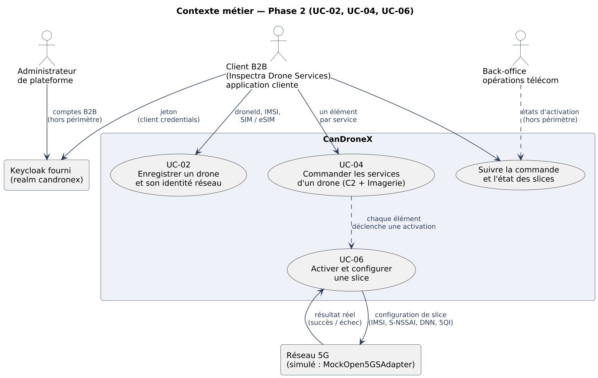

| Élément | Description |
|---:24|---:76|
| Client B2B | Application cliente d’un exploitant de drones (ex. `inspectra-demo`), identifiée par un JWT obtenu par client credentials ; propriétaire de ses drones, commandes et services. |
| Compte client (Customer Management) | Client applicatif du realm `candronex` ; son identifiant est la claim `azp` du jeton, conservée comme `clientId` sur chaque drone, commande et service. |
| Drone | Aéronef enregistré par un client : `droneId` technique, identifiant métier unique pour ce client (ex. DRN-0231), identité réseau (IMSI, SIM ou eSIM), modèle et statut. |
| Offre de service | Spécification du catalogue (C2 / URLLC, Imagerie / eMBB), décrite par ses caractéristiques réseau (sst, sd, dnn, 5qi) et de service (latence, fiabilité, débit montant). |
| Commande | Demande d’un client composée d’un élément par service demandé ; chaque élément désigne son drone, l’action `AJOUTER` et fige l’offre. |
| Demande d’activation | Traitement, pour un élément, de la configuration de la slice sur le réseau ; une seule par élément. |
| Service (inventaire) | Service de connectivité d’un drone tel que CanDroneX le connaît : en activation, actif ou en échec ; consultable sans interroger le réseau. |
| Réseau 5G | Applique la configuration de slice au profil d’abonné du drone ; simulé en Phase 2 par le `MockOpen5GSAdapter`. |

Un drone opérationnel requiert les deux services : **C2 / URLLC** porte la commande, le contrôle et la télémétrie (faible latence, haute fiabilité), et **Imagerie / eMBB** la vidéo de mission (débit montant élevé). La commande de référence contient donc deux éléments qui déclenchent deux activations indépendantes : leurs états évoluent séparément, et la commande reflète leur combinaison (§6.2).

@@ 3.2 Contexte technique
Les systèmes externes sont le client B2B, le Keycloak fourni et le réseau 5G simulé. La frontière de confiance est le réseau Docker Compose : seuls la passerelle (8080), Keycloak (8081) et la documentation Swagger UI (8082) y sont accessibles depuis l’hôte.

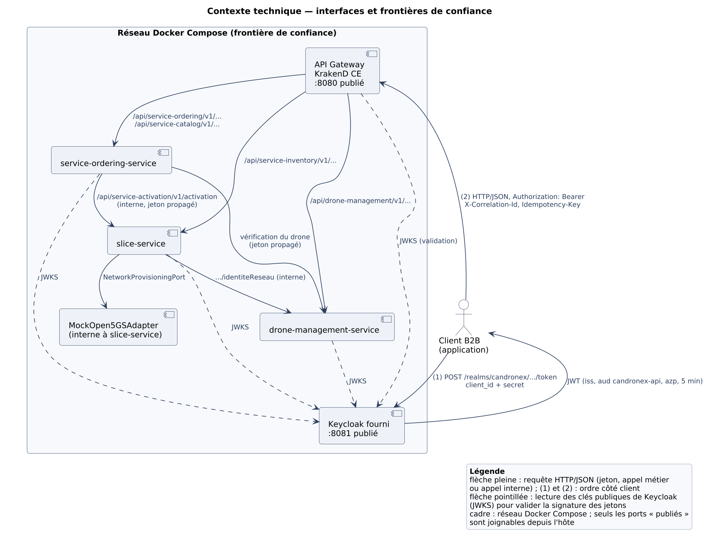

| Système externe | Interaction avec CanDroneX |
|---:24|---:76|
| Keycloak fourni (realm `candronex`) | Émet les JWT des clients de démonstration par client credentials (`POST /realms/candronex/protocol/openid-connect/token`, jeton de 5 min) ; la passerelle et chaque microservice lisent ses clés publiques (JWKS) par le réseau Docker pour valider les jetons. |
| Client B2B | Obtient d’abord son jeton auprès de Keycloak, puis appelle uniquement la passerelle en HTTP/JSON avec `Authorization: Bearer`, et selon l’opération `Idempotency-Key` et `X-Correlation-Id`. |
| Réseau 5G simulé (`MockOpen5GSAdapter`) | Interne à slice-service : reçoit la configuration de slice (IMSI, S-NSSAI, DNN, 5QI) par le `NetworkProvisioningPort` et répond succès ou échec après une latence simulée ; aucun cœur 5G n’est joint. |

Les appels de jeton (au Keycloak, port 8081) sont distincts des appels métier (à la passerelle, port 8080) : la passerelle ne délivre ni ne renouvelle aucun jeton. Les appels internes (vérification du drone, demande d’activation, résolution de l’IMSI) passent par le réseau Docker, jamais par la passerelle, et transmettent le jeton du client et l’identifiant de corrélation.

@@ 3.3 Cartographie du domaine
La cartographie de la Phase 1 est mise à jour selon les remarques reçues : le contexte « Service réseau » est séparé en **Service Activation** (TMF640, agrégat `DemandeActivation`) et **Service Inventory** (TMF638, agrégat `Service`), et le contexte « Connexion » devient **Customer Management**, assuré par le Keycloak fourni.

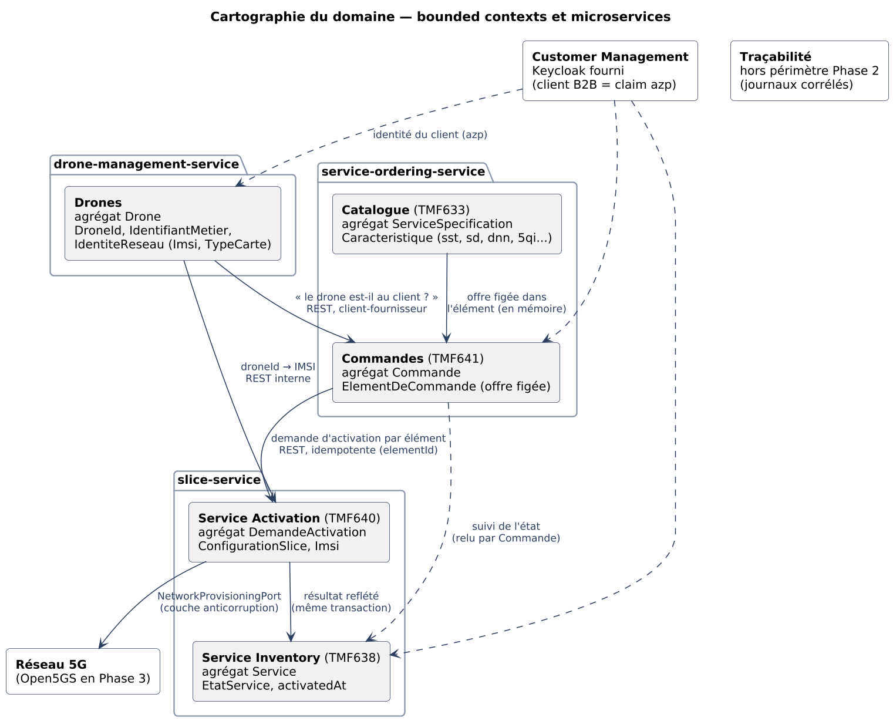

| Bounded context | Microservice | Agrégats et objets valeur | Services applicatifs et de domaine | Modèle TMF |
|---:13|---:15|---:27|---:29|---:16|
| Drones | drone-management-service | `Drone` (racine) ; `DroneId`, `IdentifiantMetier`, `IdentiteReseau` (`Imsi`, `TypeCarte`), `ClientId` | `GestionDrones` (enregistrer, consulter, résoudre l’identité réseau) | — (ressource propre à CanDroneX) |
| Catalogue | service-ordering-service | `ServiceSpecification` (racine) ; `SpecificationId`, `Caracteristique` | `ConsultationCatalogue` | TMF633 Service Catalog |
| Commandes | service-ordering-service | `Commande` (racine), `ElementDeCommande` (offre figée) ; `CleIdempotence`, empreinte | `GestionCommandes` (passer, rejouer, suivre) ; calcul de l’état global dans l’agrégat | TMF641 Service Ordering |
| Service Activation | slice-service | `DemandeActivation` (racine) ; `ConfigurationSlice` (S-NSSAI, DNN, 5QI), `Imsi` | `ReceptionActivations`, `TraitementActivations` ; port `NetworkProvisioningPort` | TMF640 Service Activation and Configuration |
| Service Inventory | slice-service | `Service` (racine) ; `EtatService`, `activatedAt` | `ConsultationInventaire` | TMF638 Service Inventory |
| Customer Management | Keycloak fourni | client applicatif (claim `azp`) | émission et validation des jetons | — |

**Relations.** Les contextes ne se référencent que par identifiant : la commande conserve le `droneId`, la demande d’activation l’`elementId` et le `commandeId`, le service d’inventaire l’`elementId`. Drones est fournisseur de Commandes et de Service Activation (relation client-fournisseur par API REST) ; le réseau est isolé derrière le `NetworkProvisioningPort`, qui joue le rôle de couche anticorruption ; Customer Management fournit l’identité du client à tous les contextes (contrat du jeton fourni, suivi en conformiste).

**Changements de frontière depuis le monolithe modulaire**

- Le module Catalogue est regroupé avec Commandes dans `service-ordering-service` : le catalogue ne sert qu’à valider et figer l’offre au moment de la commande ; un service séparé ajouterait un appel réseau à chaque commande sans bénéfice en Phase 2 (ADR-001).
- Le module « Service réseau » prévu en Phase 1 devient `slice-service`, avec deux contextes distincts dans le même service : l’inventaire n’est alimenté que par le résultat des activations, et les deux agrégats sont mis à jour dans une même transaction locale.
- Le module Connexion n’est pas réalisé : l’identité du client vient du Keycloak fourni ; Traçabilité reste hors périmètre, remplacée en Phase 2 par des journaux structurés et corrélés.
- Les interfaces C# des projets `Contracts` (`IDronesApi`, `ICatalogueApi`) sont remplacées par des API REST et des DTO ; l’échange vers Commandes n’expose plus l’IMSI (remarque de la Phase 1).

Les termes du domaine sont définis au glossaire (§12).

@@ 4.1 Style architectural et frontières de microservices
La solution est une architecture **microservices** : trois services REST synchrones derrière une passerelle unique, chacun organisé en **architecture hexagonale** (§5.2) et propriétaire de sa base PostgreSQL. Les frontières suivent les bounded contexts de la cartographie (§3.3) et les modules de la Phase 1, selon trois critères :

1. **Propriété des données** : chaque donnée a un seul service propriétaire, le seul à l’écrire ; les autres la lisent par son API.
2. **Cohésion des changements** : ce qui change et se transige ensemble reste dans le même service. Le catalogue n’est lu qu’au moment de la commande, qui fige l’offre ; il reste donc avec les commandes. La demande d’activation et le service d’inventaire sont mis à jour dans la même transaction locale (avec `activatedAt`) ; ils restent donc dans slice-service.
3. **Isolation de l’intégration réseau** : seul slice-service parle au réseau, derrière le `NetworkProvisioningPort`. C’est lui qui portera l’adaptateur Open5GS en Phase 3.

| Microservice | Responsabilité | API publique (par la passerelle) | Données possédées |
|---:19|---:29|---:27|---:25|
| drone-management-service | Enregistrer les drones d’un client (UC-02), les consulter et résoudre l’identité réseau d’un drone pour slice-service. | `drone-management/v1` : `drone`, `drone/{droneId}` ; route interne `drone/{droneId}/identiteReseau` | `drone-db`, schéma `drones` : drone (client, identifiant métier, IMSI unique, type de carte, modèle, statut) |
| service-ordering-service | Publier le catalogue des offres, prendre les commandes de façon idempotente (UC-04), en suivre les éléments et calculer l’état global (UC-05). | `service-catalog/v1` : `serviceSpecification` ; `service-ordering/v1` : `serviceOrder` | `ordering-db`, schémas `catalogue` (offres, caractéristiques) et `commandes` (commande, éléments, clé d’idempotence, empreinte) |
| slice-service | Recevoir les demandes d’activation, configurer la slice par le `NetworkProvisioningPort` (UC-06) et tenir l’inventaire des services (UC-07). | `service-inventory/v1` : `service` ; route interne `service-activation/v1/activation` | `slice-db`, schémas `activation` (demandes) et `inventaire` (services, `activatedAt`) |

**Dépendances.** Les appels entre services forment un graphe sans cycle : service-ordering-service appelle drone-management-service et slice-service, slice-service appelle drone-management-service, et drone-management-service n’appelle personne. slice-service ne rappelle jamais service-ordering-service : c’est la commande qui relit l’état des activations lors du suivi (§4.2). Le diagramme du §5.1 montre ces dépendances.

Chaque service possède sa base et ne lit ni n’écrit dans celle d’un autre : une base par conteneur PostgreSQL, un utilisateur et un mot de passe propres à chaque service. Une donnée d’un autre service ne s’obtient que par son API (ADR-001).

@@ 4.2 Communication REST
Tous les échanges sont en HTTP/JSON synchrone. Le client B2B n’appelle que la passerelle. Les appels entre services passent directement par le réseau Docker (nom DNS du service, port 8080), jamais par la passerelle. Ils transmettent le jeton du client et l’identifiant de corrélation (`PropagationContexteHandler`). Il n’y a pas de compte technique : chaque service applique les droits du client à l’origine de l’appel.

| Appelant | API sollicitée | Besoin | Route REST |
|---:17|---:17|---:30|---:36|
| Client B2B via la passerelle | API des drones | Enregistrer un drone et son identité réseau (UC-02). | `POST /api/drone-management/v1/drone` |
| Client B2B via la passerelle | API des drones | Consulter les drones du client authentifié. | `GET /api/drone-management/v1/drone`, `GET …/drone/{droneId}` |
| Client B2B via la passerelle | API du catalogue | Consulter les offres et leurs caractéristiques. | `GET /api/service-catalog/v1/serviceSpecification`, `GET …/serviceSpecification/{specificationId}` |
| Client B2B via la passerelle | API des commandes | Commander C2 et Imagerie pour un drone (UC-04). | `POST /api/service-ordering/v1/serviceOrder` avec `Idempotency-Key` |
| Client B2B via la passerelle | API des commandes | Suivre la commande et l’activation de chaque élément (UC-05, UC-06). | `GET /api/service-ordering/v1/serviceOrder/{commandeId}` |
| Client B2B via la passerelle | API d’inventaire | Consulter l’état des slices d’un drone (UC-07). | `GET /api/service-inventory/v1/service?droneId=…`, `GET …/service/{serviceId}` |
| service-ordering-service | API des drones | Vérifier que le drone existe et appartient au client avant d’accepter la commande. | `GET /api/drone-management/v1/drone/{droneId}` |
| service-ordering-service | API d’activation (interne) | Demander l’activation de chaque élément accepté. | `POST /api/service-activation/v1/activation` |
| service-ordering-service | API d’activation (interne) | Relire l’état des activations lors du suivi de la commande. | `GET /api/service-activation/v1/activation?elementId=…` |
| slice-service | API des drones (interne) | Résoudre le `droneId` en IMSI et type de carte. | `GET /api/drone-management/v1/drone/{droneId}/identiteReseau` |

### Demandes, réponses et erreurs

- Chaque API définit ses propres DTO (records de la couche Api) ; les entités du domaine et les tables ne sont jamais exposées. Les champs JSON sont en camelCase dans le langage ubiquitaire, les dates en ISO 8601 UTC et les identifiants en UUID. Un service qui en appelle un autre a sa propre copie du DTO distant (ex. `IdentiteReseauDto`) et n’en lit que les champs utiles.
- Une création répond `201 Created` avec l’en-tête `Location`. Une demande d’activation répond `202 Accepted`, car elle est traitée en arrière-plan. Un rejeu idempotent répond `200 OK` avec la ressource existante.
- Les erreurs suivent la RFC 9457 (`application/problem+json`), avec `traceId` et `correlationId` :

| Code | Signification dans CanDroneX |
|---:12|---:88|
| 400 | Requête mal formée ou champ invalide (`ValidationProblemDetails`, avec les champs en erreur). |
| 401 | Jeton absent ou invalide. La passerelle refuse avant le service, et chaque service revalide (§4.4). |
| 404 | Ressource absente **ou appartenant à un autre client** : la même réponse, pour ne pas révéler son existence. |
| 409 | Conflit : IMSI ou identifiant métier déjà utilisé, ou clé d’idempotence réutilisée avec un autre contenu. |
| 422 | Règle métier non respectée : drone inconnu du client, offre inconnue, type de carte autre que SIM ou eSIM. |
| 503 | Dépendance indisponible : la demande n’a pas été traitée et peut être rejouée. |

### Délais d’attente et réaction aux échecs

Chaque client HTTP interne utilise le gestionnaire de résilience standard de .NET (Microsoft.Extensions.Http.Resilience) : 2 s par tentative, une seule reprise, 4 s au total et un disjoncteur. La reprise est sûre parce que les deux appels qui écrivent sont idempotents.

| Appel | Si l’appelé est lent ou indisponible |
|---:30|---:70|
| ordering → drone (prise de commande) | `503` au client et rien n’est enregistré ; le client rejoue avec la même clé. |
| ordering → slice (demande d’activation) | La commande est tout de même acceptée (`201`) : les éléments restent `EN_ATTENTE` et l’envoi est relancé au prochain suivi ou au rejeu de la clé. |
| ordering → slice (suivi) | `200` avec le dernier état connu des éléments ; la relecture reprend au suivi suivant. |
| slice → drone (identité réseau) | `503` à service-ordering-service : l’élément reste `EN_ATTENTE` et sera relancé. |
| slice → réseau (`NetworkProvisioningPort`) | Au-delà de 5 s, la demande passe à `ECHOUEE` (`DELAI_DEPASSE`) ; une erreur de l’adaptateur donne `RESEAU_INJOIGNABLE`. |
| passerelle → service | Délai de 5 s, ou 10 s sur les routes de commande. Un service injoignable donne `500` sans corps : c’est une limite acceptée de KrakenD CE (ADR-003). |

Les cycles sont évités par construction : les appels suivent le graphe du §4.1, et la mise à jour de la commande se fait en *pull* (la commande relit l’activation) plutôt qu’en *push* (slice-service rappellerait la commande). ADR-004 détaille ces choix.

### Idempotence et cohérence des données

- **Commande** : le couple (client, `Idempotency-Key`) est unique dans `ordering-db`. Une empreinte SHA-256 du contenu est conservée avec la commande. Une même clé avec le même contenu renvoie la commande existante (`200`) ; avec un autre contenu, elle donne `409`. La commande et ses éléments sont écrits en une transaction. Si deux rejeux simultanés arrivent, la contrainte d’unicité départage les écritures : la seconde relit la commande enregistrée.
- **Activation** : l’`elementId` est unique dans `slice-db`. Une seconde demande pour le même élément renvoie la demande existante (`200`), sans nouvelle configuration réseau. Le mock est lui aussi idempotent pour un couple (IMSI, S-NSSAI).
- **Entre services** : la cohérence est à terme, sans transaction distribuée. slice-service est la source de vérité de l’activation, et la commande en garde une copie mise à jour au suivi. L’état d’un élément ne recule jamais (fonction SQL `commandes.rang_etat`), si bien que deux suivis concurrents ne peuvent pas ramener un élément `ACTIF` à `EN_ACTIVATION`.

Les ports hexagonaux isolent ces appels du domaine. Les services applicatifs ne connaissent que des interfaces (`IRegistreDrones`, `IActivationServices`, `IResolutionIdentiteReseau`), implémentées par des adaptateurs HTTP de la couche Infrastructure. Le domaine ignore HTTP, la résilience et le jeton (§5.2).

@@ 4.3 Contrats REST et OpenAPI
Chaque API est versionnée dans son chemin : `/api/{api}/v1/{ressource}`, où `{api}` reprend le nom de l’API TM Forum correspondante (ex. `/api/service-ordering/v1/serviceOrder`). Une version 2 serait exposée sous `v2` à côté de la première, et la passerelle routerait l’une et l’autre.

Les contrats OpenAPI sont **générés depuis le code** (Swashbuckle) : DTO, commentaires XML, attributs de validation et codes de réponse déclarés sur les contrôleurs. Un filtre commun (`ConventionsContrat`) ajoute à chaque opération l’en-tête `X-Correlation-Id`, les réponses d’erreur Problem Details et l’exigence du jeton. Un second filtre (`ExemplesContrat`) donne, pour chaque opération, un exemple du corps de requête et de chaque réponse documentée (succès, rejeu et erreurs), tirés d’appels réels par la passerelle. Un test de `tests/Contrats.Tests` échoue s’il en manque un, sauf pour 401 et 500, qui n’ont pas de corps utile. Les contrats sont exportés et versionnés dans `docs/openapi`. Un test de chaque service échoue si le contrat ne correspond plus à l’API (§8.4).

| Contrat | Contenu |
|---:30|---:70|
| `docs/openapi/api-gateway.yaml` | Contrat public de la passerelle : les 9 routes publiques, `securitySchemes` `oauth2` (flux `clientCredentials`) et `bearer`. |
| `docs/openapi/drone-management-service.yaml` | API des drones, route interne `identiteReseau` comprise. |
| `docs/openapi/service-ordering-service.yaml` | API du catalogue et des commandes. |
| `docs/openapi/slice-service.yaml` | API d’inventaire et API interne d’activation. |

| Méthode | Chemin | Intention |
|---:11|---:44|---:45|
| POST | `/api/drone-management/v1/drone` | Enregistrer un drone (UC-02) : `201`, `400`, `409` (IMSI ou identifiant déjà utilisé), `422`. |
| GET | `/api/drone-management/v1/drone` | Lister les drones du client (l’IMSI n’est jamais retournée). |
| GET | `/api/drone-management/v1/drone/{droneId}` | Consulter un drone : `404` s’il est absent ou à un autre client. |
| GET | `/api/drone-management/v1/drone/{droneId}/identiteReseau` | Interne : IMSI et type de carte, pour slice-service. |
| GET | `/api/service-catalog/v1/serviceSpecification` | Lister les offres et leurs caractéristiques. |
| GET | `/api/service-catalog/v1/serviceSpecification/{specificationId}` | Consulter une offre (`C2_URLLC`, `IMAGERIE_EMBB`). |
| POST | `/api/service-ordering/v1/serviceOrder` | Commander (UC-04) : `201` et `Location`, `200` au rejeu, `409`, `422`, `503`. |
| GET | `/api/service-ordering/v1/serviceOrder/{commandeId}` | Suivre la commande : état global, état et `activatedAt` de chaque élément. |
| POST | `/api/service-activation/v1/activation` | Interne : demander l’activation d’un élément (`202`, `200` au rejeu, `422`, `503`). |
| GET | `/api/service-activation/v1/activation?elementId=…` | Interne : suivre les activations des éléments du client. |
| GET | `/api/service-inventory/v1/service?droneId=…` | Lister les services du client ou d’un drone (UC-07). |
| GET | `/api/service-inventory/v1/service/{serviceId}` | Consulter un service de l’inventaire. |

**Exemple : commande de référence (UC-04).** Requête par la passerelle, avec le jeton d’`inspectra-demo` :

```
POST /api/service-ordering/v1/serviceOrder
Authorization: Bearer <JWT>
Idempotency-Key: demo-0001
Content-Type: application/json

{ "elements": [
    { "droneId": "00000000-0000-0000-0000-000000000231", "action": "AJOUTER", "specification": "C2_URLLC" },
    { "droneId": "00000000-0000-0000-0000-000000000231", "action": "AJOUTER", "specification": "IMAGERIE_EMBB" } ] }
```

Réponse `201 Created`, `Location: /api/service-ordering/v1/serviceOrder/9b0b35d9-…` (extrait) :

```
{ "id": "9b0b35d9-7be8-40f4-b0ec-c0ec7614868e",
  "etat": "EN_COURS",
  "acceptedAt": "2026-10-24T21:29:29.536Z",
  "elements": [
    { "id": "abbda7ec-…", "droneId": "00000000-0000-0000-0000-000000000231",
      "action": "AJOUTER", "specification": "C2_URLLC", "versionSpecification": "1.0",
      "caracteristiques": [ { "nom": "sst", "valeur": "2" }, { "nom": "sd", "valeur": "000001" },
                            { "nom": "dnn", "valeur": "c2.candronex" }, { "nom": "5qi", "valeur": "82" }, … ],
      "etat": "EN_ACTIVATION", "causeEchec": null,
      "serviceId": "391f3db0-…", "activatedAt": null },
    { "id": "a587db15-…", "specification": "IMAGERIE_EMBB", "etat": "EN_ACTIVATION", … } ] }
```

Deux secondes plus tard, `GET …/serviceOrder/9b0b35d9-…` renvoie `COMPLETEE`, avec les deux éléments `ACTIF` et leur `activatedAt`. Rejouer la même clé avec un contenu différent donne `409` :

```
{ "type": "https://tools.ietf.org/html/rfc9110#section-15.5.10", "title": "Conflit", "status": 409,
  "detail": "La clé d'idempotence « demo-0001 » a déjà été utilisée pour une commande au contenu différent.",
  "instance": "/api/service-ordering/v1/serviceOrder",
  "traceId": "00-395b91b7…-00", "correlationId": "d1fcf59a-…" }
```

**Accès à Swagger.** Une fois le système démarré, Swagger UI est servi sur `http://localhost:8082`. Le contrat de la passerelle s’ouvre par défaut, et les trois contrats des services se choisissent dans la liste. « Try it out » appelle la passerelle. Le contrat déclare le flux `clientCredentials` avec l’URL de jeton `http://localhost:8081/realms/candronex/protocol/openid-connect/token`. Le Keycloak fourni ne renvoie toutefois pas d’en-tête CORS : on obtient donc le jeton avec curl (§7.2), puis on le colle dans le schéma `bearer` (bouton *Authorize*).

Les contrats décrivent les DTO, jamais les tables. Par exemple, la réponse d’un drone ne contient pas l’IMSI, et les caractéristiques figées d’un élément (une colonne JSONB) sont exposées comme une liste `nom`/`valeur`.

@@ 4.4 API Gateway et circulation du jeton
La passerelle est **KrakenD CE 2.7.2** (`devopsfaith/krakend`) : une configuration déclarative (`krakend/krakend.json`), sans état ni base de données. ADR-003 justifie ce choix.

| Élément | Configuration retenue |
|---:22|---:78|
| Routage | 9 routes publiques, chacune vers un seul service et sous le même chemin, sans agrégation. Les routes internes (`identiteReseau`, `service-activation`) ne sont pas déclarées : la passerelle répond `404`. |
| Validation du JWT | `auth/validator` sur chaque route : RS256, clés lues sur `http://keycloak:8080/realms/candronex/protocol/openid-connect/certs`, émetteur `http://localhost:8081/realms/candronex`, audience `candronex-api`. Un jeton refusé donne `401` sans atteindre le service. |
| En-têtes transmis | `Authorization`, `Content-Type`, `X-Correlation-Id`, et `Idempotency-Key` sur `POST serviceOrder` seulement. Tous les autres sont retirés : un en-tête `X-Client-Id` forgé n’arrive jamais au service. La seule chaîne de requête transmise est `droneId`, sur l’inventaire. |
| Réponses | Encodage `no-op` : le code, le corps et les en-têtes du service sont transmis tels quels (Problem Details, `Location`). |
| CORS | Origines `*`, méthodes `GET` et `POST`, en-têtes autorisés `Authorization`, `Content-Type`, `Idempotency-Key`, `X-Correlation-Id` ; `X-Correlation-Id` et `Location` exposés. |
| Corrélation | La passerelle transmet `X-Correlation-Id`. Chaque service en crée un s’il est absent, le renvoie dans la réponse, le journalise et le propage à ses appels. |
| Délais | 5 s par défaut, 10 s sur les routes de commande (qui appellent deux autres services). |
| Service indisponible | KrakenD CE répond `500` sans corps et ne distingue pas un service en panne. Cette limite est documentée et acceptée (ADR-003). Derrière la passerelle, une dépendance indisponible donne un `503` Problem Details explicite. |

**Contrat du jeton.** Le Keycloak fourni émet, par client credentials, un JWT RS256 valide 5 minutes. La signature, `exp`, `iss` (`http://localhost:8081/realms/candronex`) et `aud` (`candronex-api`) sont vérifiés. L’identité du client B2B est la claim `azp` (`inspectra-demo`, `aerotech-demo`). Un jeton sans l’audience, comme celui de `client-management-service`, est refusé.

**Défense en profondeur.** Chaque microservice revalide le jeton (même émetteur, audience et signature), car les routes internes ne passent pas par la passerelle. Le document de découverte de Keycloak annonce un hôte injoignable depuis les conteneurs ; les services lisent donc directement les clés publiques sur `keycloak:8080` (`JwksRetriever`). Les autorisations B2B sont ensuite appliquées dans les données : chaque lecture et chaque écriture sont filtrées par `client_id = azp`, et une ressource d’un autre client donne `404`.

| Composant | Responsabilité dans le flux |
|---:20|---:80|
| API Gateway | Point d’entrée unique : valide le JWT, route les appels, filtre les en-têtes et transmet le jeton Bearer tel quel ; n’émet ni ne renouvelle aucun jeton. |
| Microservices | Revalident le JWT, tirent le client de la claim `azp`, filtrent toutes les données par client et propagent le même jeton à leurs appels internes. |
| Keycloak fourni | Émet les jetons des clients de démonstration (realm `candronex` importé au démarrage) et publie ses clés publiques (JWKS). |
| Client B2B | Obtient un jeton par client credentials, l’envoie en `Authorization: Bearer` et le renouvelle avant son expiration. |

@@ 5. Vue des blocs de construction — 4+1 : Logique et Développement
Les chapitres 1 à 8 couvrent les sections Arc42 demandées. Les cinq vues 4+1 correspondent aux diagrammes et explications suivants.

| Vue 4+1 | Section(s) | Diagrammes et contenu |
|---:16|---:18|---:66|
| Logique | §3.3, §5.1, §5.2 | Cartographie du domaine, décomposition en microservices, hexagones des trois services. |
| Développement | §5.3 | Arborescence du dépôt, projets par couche, règles de dépendance. |
| Processus | §6.1, §6.2 | Séquences du jeton et d’UC-02, d’UC-04 et d’UC-06 ; cycle de vie des éléments, demandes et services. |
| Déploiement | §7.1 | Conteneurs Docker Compose, ports, réseau, volumes. |
| Scénarios | §1.2, §6.1 | Cas d’utilisation de la Phase 2 et scénarios de référence, vérifiés par `scripts/tester-cas-attendus.sh` (§10.3). |

@@ 5.1 Décomposition en microservices — vue Logique
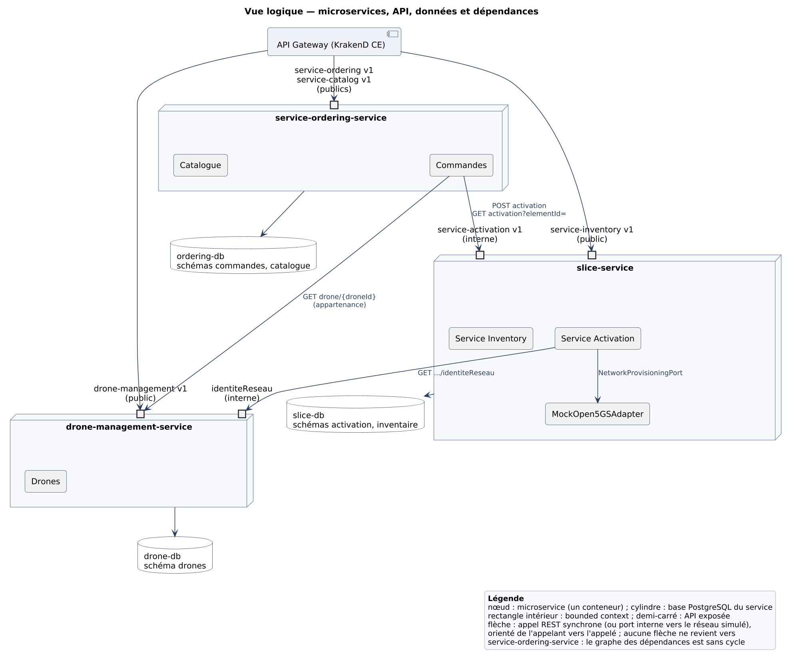

| Microservice | Bounded contexts | API | Base | Appelle |
|---:22|---:20|---:26|---:14|---:18|
| drone-management-service | Drones | `drone-management/v1` (publique), `identiteReseau` (interne) | `drone-db` | — |
| service-ordering-service | Catalogue, Commandes | `service-catalog/v1`, `service-ordering/v1` (publiques) | `ordering-db` | drone-management-service, slice-service |
| slice-service | Service Activation, Service Inventory | `service-inventory/v1` (publique), `service-activation/v1` (interne) | `slice-db` | drone-management-service ; réseau simulé par le port |

Le découpage reprend la cartographie du §3.3. Chaque bounded context appartient à un seul service, et un service ne regroupe deux contextes que lorsqu’ils partagent une même transaction (Commandes avec Catalogue figé, Service Activation avec Service Inventory). ADR-001 consigne ce choix et les découpages écartés. Customer Management reste à l’extérieur, assuré par le Keycloak fourni.

@@ 5.2 Structure interne d’un service — architecture hexagonale
Les trois services ont la même structure en quatre projets. **Domain** contient les agrégats, objets valeur et règles, sans aucune dépendance. **Application** contient les services applicatifs, ainsi que les ports d’entrée et de sortie qu’ils définissent. **Infrastructure** contient les adaptateurs de sortie : PostgreSQL avec Npgsql, HTTP vers les autres services, réseau simulé et file en mémoire. **Api** contient les adaptateurs d’entrée REST et la composition. slice-service, qui porte UC-06, est détaillé ci-dessous.

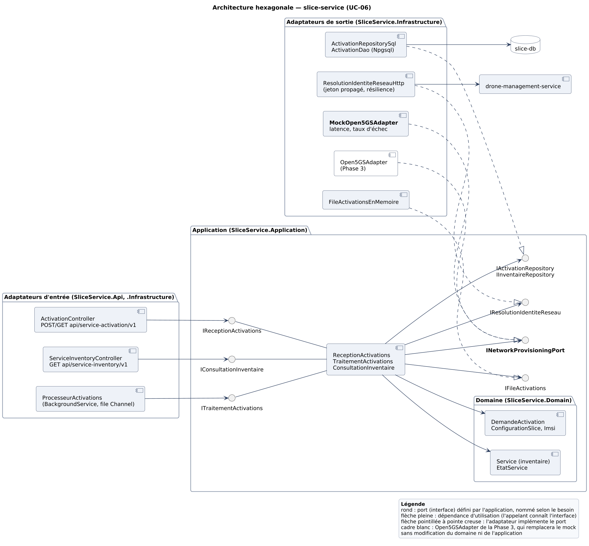

| Élément | Rôle dans slice-service |
|---:28|---:72|
| `ActivationController`, `ServiceInventoryController` | Adaptateurs d’entrée REST : DTO, validation, codes HTTP. Ils appellent les ports `IReceptionActivations` et `IConsultationInventaire`. |
| `ProcesseurActivations` | Adaptateur d’entrée en arrière-plan (`BackgroundService`) : il lit la file et appelle `ITraitementActivations`, jusqu’à 500 activations simultanées ; au démarrage, il relit les demandes `RECUE`. |
| `ReceptionActivations` | Vérifie l’idempotence, résout l’IMSI, valide la `ConfigurationSlice`, enregistre la demande et le service en une transaction, puis met la demande en file. |
| `TraitementActivations` | Appelle le `NetworkProvisioningPort` avec un délai maximal, puis enregistre `REUSSIE` et `ACTIF`, ou `ECHOUEE` et `EN_ECHEC`, en une transaction. |
| Domaine | `DemandeActivation`, `ConfigurationSlice` (S-NSSAI = sst + sd, DNN, 5QI), `Imsi`, `Service` et `EtatService` ; transitions et invariants, sans aucune référence technique. |
| Ports de sortie | `IActivationRepository` et `IInventaireRepository`, `IResolutionIdentiteReseau`, `INetworkProvisioningPort`, `IFileActivations`. |
| Adaptateurs de sortie | `ActivationRepositorySql` (Npgsql), `ResolutionIdentiteReseauHttp` (jeton propagé, résilience), `MockOpen5GSAdapter`, `FileActivationsEnMemoire` (Channel). |

**NetworkProvisioningPort.** Le port est défini par l’application, dans les termes du domaine :

```
public interface INetworkProvisioningPort
{
    // Associe la slice au profil de l'abonné. Idempotent ; un délai dépassé
    // se signale par l'annulation du jeton d'annulation.
    Task<ResultatProvisionnement> ConfigurerSliceAsync(
        Imsi imsi, ConfigurationSlice configuration, CancellationToken ct);
}
```

Le `MockOpen5GSAdapter` simule le cœur 5G. Il attend une latence tirée uniformément entre `MockOpen5GS__LatenceMinMs` et `MockOpen5GS__LatenceMaxMs` (300 et 1500 ms par défaut), puis refuse la configuration avec la probabilité `MockOpen5GS__TauxEchec` (0 par défaut, cause `ECHEC_SIMULE`). Il garde en mémoire les slices associées à chaque IMSI : rejouer une configuration déjà appliquée réussit sans créer de seconde association. Le futur `Open5GSAdapter` implémentera la même interface ; le remplacement se limite à l’enregistrement de l’adaptateur dans `InfrastructureExtensions`, sans modifier le domaine ni l’application (ADR-002).

Les deux autres services suivent le même modèle, avec moins d’adaptateurs.

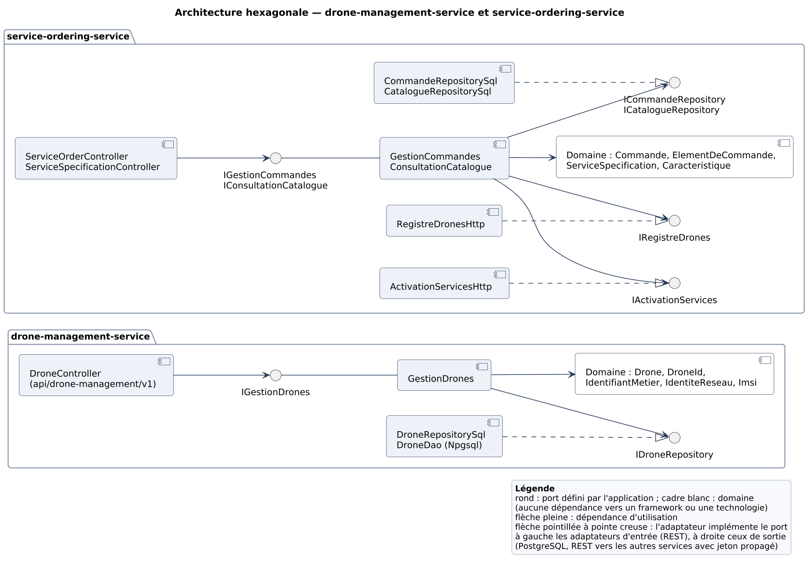

Dans service-ordering-service, `GestionCommandes` dépend de quatre ports de sortie : `ICommandeRepository`, `ICatalogueRepository`, `IRegistreDrones` (vérification du drone) et `IActivationServices` (demande et suivi des activations). Les deux derniers sont implémentés par des adaptateurs HTTP : l’agrégat `Commande` ne sait pas que les drones et les activations sont dans d’autres services. drone-management-service n’a qu’un port de sortie (`IDroneRepository`), car il n’appelle aucun service.

@@ 5.3 Organisation du code — vue Développement
Le code est dans un seul dépôt et une seule solution (`CanDroneX.sln`). Chaque microservice a son propre dossier, son Dockerfile et son script de base de données, et se construit et se déploie seul.

```
CanDroneX/
├─ CanDroneX.sln, Directory.Build.props, Directory.Packages.props
├─ docker-compose.yml, .env.example, krakend/, keycloak/
├─ services/
│  ├─ drone-management-service/
│  │  ├─ src/   DroneManagement.{Domain, Application, Infrastructure, Api}
│  │  ├─ tests/ DroneManagement.{Domain, Application, Infrastructure, Api}.Tests
│  │  ├─ db/init.sql, Dockerfile
│  ├─ service-ordering-service/   (même structure, ServiceOrdering.*)
│  └─ slice-service/              (même structure, SliceService.*, db/mesures/)
├─ tests/Contrats.Tests            (assemble le contrat de la passerelle)
├─ load-tests/                     (k6, analyse, résultats)
├─ scripts/                        (démonstration, cas attendus, export des contrats)
└─ docs/                           (openapi/, diagrammes/, rapport/, décisions, mesures)
```

| Projet | Peut référencer | Contenu |
|---:20|---:28|---:52|
| `*.Domain` | rien (aucun paquet NuGet) | Agrégats, objets valeur, états et exceptions métier. |
| `*.Application` | Domain | Services applicatifs, ports d’entrée et de sortie, commandes et résultats. |
| `*.Infrastructure` | Application (et Domain) ; Npgsql, résilience HTTP | DAO et dépôts SQL, clients HTTP, adaptateur réseau, file et processeur. |
| `*.Api` | Application, Infrastructure | Contrôleurs et DTO, sécurité JWT, corrélation et journaux, erreurs, OpenAPI ; composition dans `Program.cs`. |
| `*.Tests` | la couche testée | Tests unitaires (Domain, Application) et d’intégration (Infrastructure avec Testcontainers, Api avec WebApplicationFactory). |

**Règles imposées par le code.**

- Le sens des dépendances est fixé par les références de projet. Le projet Domain n’en a aucune, ni vers un projet ni vers un paquet : y utiliser ASP.NET Core ou Npgsql ne compile pas. Les avertissements sont traités comme des erreurs (`TreatWarningsAsErrors`), et les versions des paquets sont centralisées dans `Directory.Packages.props`.
- Aucun projet n’est partagé entre services, et aucun service ne référence un projet d’un autre service. Le code transversal (sécurité, corrélation, erreurs, conventions OpenAPI) est copié dans chaque service : on accepte cette duplication pour qu’un service évolue et se déploie sans les autres.
- Les entités internes ne traversent pas les frontières. Un service ne connaît d’un autre que le contrat de son API, au travers de ses propres DTO, et les identifiants circulent sous forme d’UUID.

@@ 6. Vue d’exécution — 4+1 : Processus
Cette vue suit un appel B2B de bout en bout, de l’obtention du jeton à l’activation des deux slices du drone DRN-0231, puis le cycle de vie des objets qui portent l’état. Les numéros des diagrammes renvoient aux étapes citées dans le texte.

@@ 6.1 Scénarios de référence
### Jeton, puis UC-02 par la passerelle

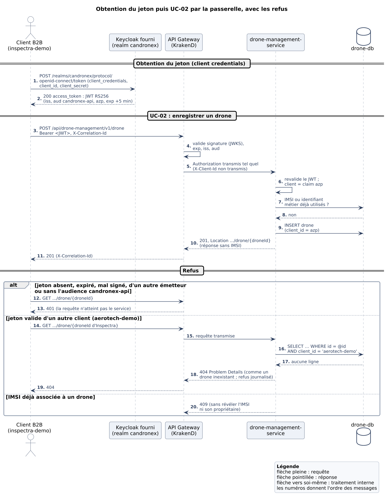

Le client obtient un jeton auprès de Keycloak (étapes 1-2), puis appelle la passerelle (3). La passerelle valide le jeton (4) et transmet l’`Authorization` tel quel (5). drone-management-service revalide le jeton et prend le client dans `azp` (6). Il vérifie ensuite l’unicité de l’IMSI et de l’identifiant métier (7-8), puis enregistre le drone pour ce client (9). La réponse `201` ne contient pas l’IMSI (10-11).

### UC-04 puis UC-06 : commande C2 et Imagerie

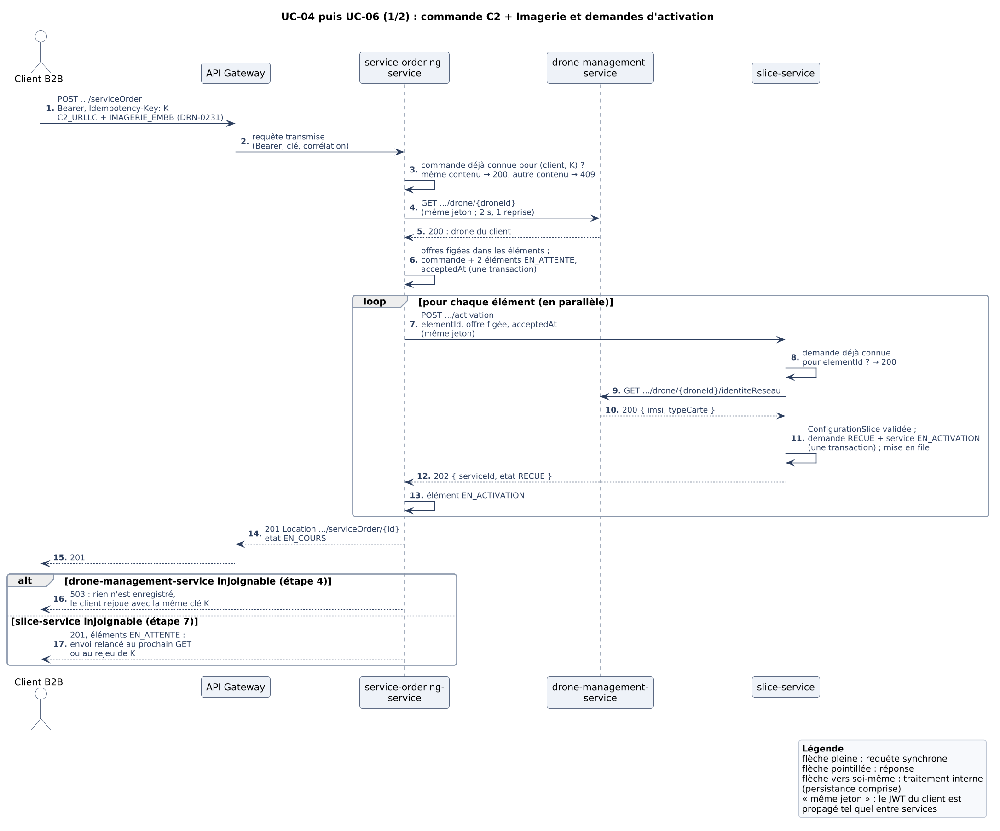

service-ordering-service vérifie d’abord la clé d’idempotence (3), puis le drone auprès de drone-management-service, avec le jeton du client (4-5). Il fige alors l’offre dans chaque élément et enregistre la commande avec `acceptedAt` (6). Il demande ensuite l’activation des deux éléments en parallèle (7). Pour chacun, slice-service vérifie l’idempotence par `elementId` (8), résout l’IMSI (9-10), enregistre la demande `RECUE` et le service `EN_ACTIVATION`, puis met la demande en file (11) et répond `202` (12). Le client reçoit `201` avec l’état `EN_COURS` (14-15).

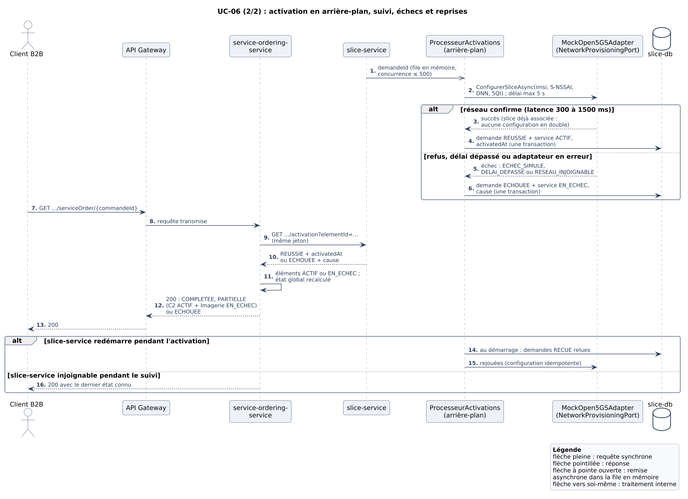

En arrière-plan, le processeur appelle le mock par le `NetworkProvisioningPort` (1-2). Selon la réponse, il enregistre `REUSSIE` et `ACTIF` avec `activatedAt`, ou `ECHOUEE` et `EN_ECHEC` avec la cause (3-6). Quand le client suit sa commande (7-8), service-ordering-service relit les activations (9-10) et recalcule l’état global (11). Le client voit `COMPLETEE`, `PARTIELLE` (C2 actif, Imagerie en échec) ou `ECHOUEE` (12-13).

### Refus et défaillances démontrés

| Cas | Où le refus se produit | Réponse |
|---:30|---:28|---:42|
| Sans jeton, jeton expiré, mal signé, d’un autre émetteur ou sans audience | Passerelle (puis le service, s’il est appelé directement) | `401`, la requête n’atteint pas le service. |
| Jeton valide d’`aerotech-demo` sur un drone d’`inspectra-demo` | drone-management-service (filtre `client_id`) | `404`, comme pour un drone inexistant ; refus journalisé. |
| Commande pour le drone d’un autre client | service-ordering-service (drone introuvable avec le jeton du client) | `422`, rien n’est enregistré. |
| IMSI déjà associée | drone-management-service (unicité) | `409`, sans révéler le propriétaire. |
| drone-management-service injoignable à la commande | service-ordering-service | `503`, rien n’est enregistré ; rejeu avec la même clé. |
| slice-service injoignable à la commande | service-ordering-service | `201`, éléments `EN_ATTENTE`, relancés au suivi ou au rejeu. |
| Réseau qui refuse (`MOCK_TAUX_ECHEC=1`) | slice-service, en arrière-plan | Éléments `EN_ECHEC` avec la cause, commande `ECHOUEE`. |
| slice-service redémarré pendant une activation | slice-service, au démarrage | Les demandes `RECUE` sont relues et rejouées sans doublon. |

@@ 6.2 Cycle de vie d’une commande et d’une activation
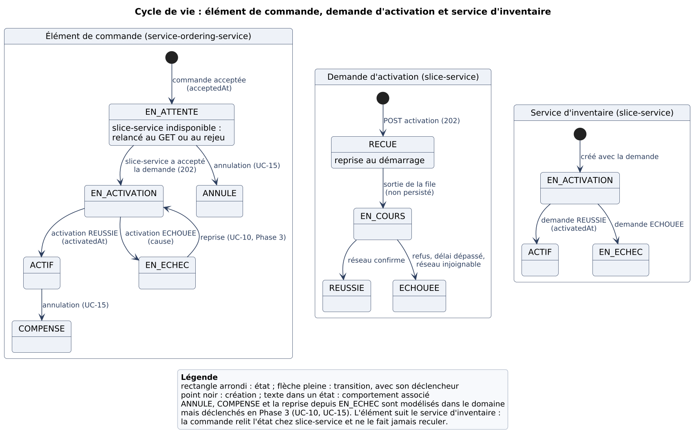

Trois objets portent l’état, chacun dans le service qui en est propriétaire. L’**élément de commande** (service-ordering-service) suit la commande du point de vue du client. La **demande d’activation** (slice-service) suit le traitement réseau. Le **service d’inventaire** (slice-service) décrit la slice telle que CanDroneX la connaît.

| État de l’élément | Signification | Transition suivante |
|---:20|---:44|---:36|
| `EN_ATTENTE` | Commande acceptée (`acceptedAt`), activation pas encore acceptée par slice-service. | `EN_ACTIVATION` dès que slice-service répond `202` ou `200`. |
| `EN_ACTIVATION` | Demande acceptée par slice-service, traitement réseau en cours. | `ACTIF` ou `EN_ECHEC`, relu au suivi. |
| `ACTIF` | Slice configurée ; `activatedAt` copié de l’inventaire. | `COMPENSE` à l’annulation (UC-15, Phase 3). |
| `EN_ECHEC` | Le réseau a refusé, a dépassé le délai ou était injoignable ; cause conservée. | `EN_ACTIVATION` à la reprise (UC-10, Phase 3). |
| `ANNULE`, `COMPENSE` | Modélisés dans le domaine, déclenchés en Phase 3. | — |

**Horodatages.** `acceptedAt` est fixé par service-ordering-service quand la commande est enregistrée, puis transmis à slice-service avec la demande. `activatedAt` est fixé par slice-service dans la transaction qui passe le service à `ACTIF`. Les deux valeurs sont dans `slice-db`, ce qui permet de calculer le P95 du délai d’activation en une requête SQL (§10.4). La demande ne passe à `EN_COURS` qu’en mémoire, quand le processeur la prend dans la file : cet état n’est pas écrit en base, ce qui économise une écriture par activation (ADR-005).

**État global de la commande.** Il n’est pas stocké : l’agrégat `Commande` le calcule à partir de ses éléments, en évaluant les règles dans l’ordre suivant.

1. Tous les éléments `EN_ATTENTE` : `RECUE`.
2. Tous les éléments `ANNULE` ou `COMPENSE` : `ANNULEE`.
3. Au moins un élément `EN_ATTENTE` ou `EN_ACTIVATION` : `EN_COURS`.
4. Au moins un `ACTIF` et au moins un `EN_ECHEC` : `PARTIELLE`.
5. Aucun `ACTIF` et au moins un `EN_ECHEC` : `ECHOUEE`.
6. Sinon (tous les éléments terminés sont `ACTIF`) : `COMPLETEE`.

**Résultats partiels.** Les deux activations sont indépendantes. Si C2 est actif et qu’Imagerie échoue, la commande est `PARTIELLE`, et non `ECHOUEE` : le lien C2 actif est l’information critique pour l’exploitant, et chaque élément garde son propre état et sa cause.

**Échecs simulés.** `MOCK_TAUX_ECHEC` règle la proportion de refus du mock (0 par défaut, 1 pour démontrer l’échec). Un délai réseau de plus de 5 s donne `DELAI_DEPASSE`, et une erreur de l’adaptateur `RESEAU_INJOIGNABLE`. Dans tous les cas, la demande passe à `ECHOUEE` et le service à `EN_ECHEC` dans la même transaction.

**Répétitions et doublons.** Une même demande peut être répétée à quatre niveaux, et chacun est idempotent :

- le client rejoue la commande avec la même clé : la commande existante est renvoyée ;
- service-ordering-service relance la demande d’un élément `EN_ATTENTE` : l’`elementId` unique renvoie la demande existante ;
- slice-service redémarre et rejoue les demandes `RECUE` : le mock n’associe pas deux fois la même slice ;
- deux suivis concurrents mettent à jour le même élément : `rang_etat` empêche tout retour en arrière.

Le scénario de rejeu des tests d’intégration vérifie qu’il n’y a ni commande, ni demande, ni association réseau en double.

@@ 7. Vue de déploiement — 4+1
Cette vue montre le système exécuté localement avec Docker Compose (`docker-compose.yml`) pour la Phase 2 : dix conteneurs, dont k6 qui n’est lancé que pour les mesures.

@@ 7.1 Topologie de déploiement
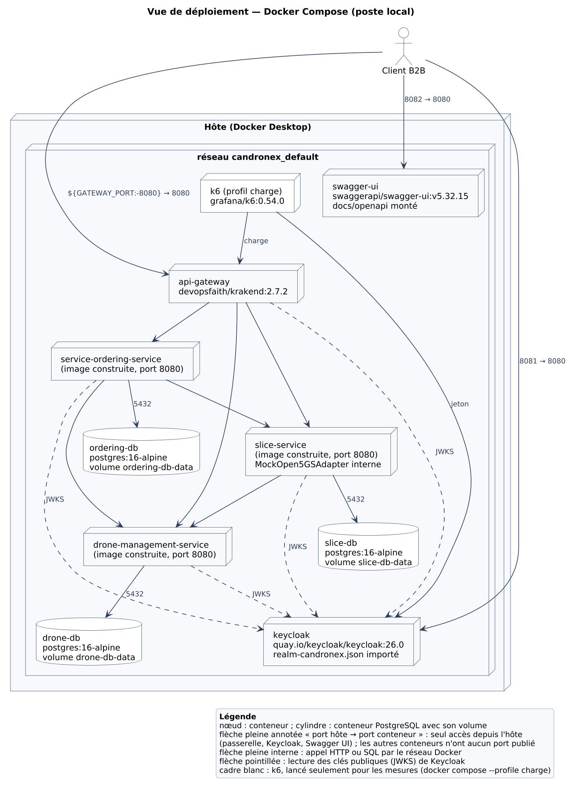

| Conteneur | Image | Port publié sur l’hôte | Volume |
|---:24|---:32|---:22|---:22|
| `api-gateway` | `devopsfaith/krakend:2.7.2` | `${GATEWAY_PORT:-8080}` → 8080 | `krakend.json` (lecture seule) |
| `keycloak` | `quay.io/keycloak/keycloak:26.0` | 8081 → 8080 | `realm-candronex.json` importé |
| `swagger-ui` | `swaggerapi/swagger-ui:v5.32.15` | `${SWAGGER_UI_PORT:-8082}` → 8080 | `docs/openapi` (lecture seule) |
| `drone-management-service` | construite (`services/drone-management-service/Dockerfile`) | aucun | — |
| `service-ordering-service` | construite | aucun | — |
| `slice-service` | construite ; `MockOpen5GSAdapter` interne | aucun | — |
| `drone-db`, `ordering-db`, `slice-db` | `postgres:16-alpine` | aucun | `drone-db-data`, `ordering-db-data`, `slice-db-data` ; `db/init.sql` au premier démarrage |
| `k6` (profil `charge`) | `grafana/k6:0.54.0` | aucun | `load-tests/` (scripts et résultats) |

**Réseau.** Tous les conteneurs sont sur le réseau par défaut du projet (`candronex_default`) et se joignent par leur nom de service. Seuls la passerelle, Keycloak et Swagger UI publient un port. Les microservices et les bases ne sont pas joignables depuis l’hôte, ce que vérifie le script des cas attendus.

**Démarrage ordonné.** Chaque service attend que sa base soit saine (`pg_isready`). La passerelle attend que Keycloak soit sain (`/health/ready`).

| Variable (services) | Rôle |
|---:36|---:64|
| `ConnectionStrings__Drones`, `__ServiceOrdering`, `__Slices` | Base propre du service (`Maximum Pool Size=80`) ; mot de passe tiré de `.env`. |
| `Jwt__Emetteur`, `Jwt__Audience`, `Jwt__JwksUrl` | Contrat du jeton : `http://localhost:8081/realms/candronex`, `candronex-api`, clés sur `keycloak:8080`. |
| `ServicesDistants__DroneManagementUrl`, `__SliceServiceUrl` | Adresses internes des services appelés. |
| `MockOpen5GS__LatenceMinMs`, `__LatenceMaxMs`, `__TauxEchec` | Réseau simulé, alimentées par `MOCK_LATENCE_MIN_MS` (300), `MOCK_LATENCE_MAX_MS` (1500) et `MOCK_TAUX_ECHEC` (0). |
| `Activation__DelaiMaxReseau`, `Processeur__ConcurrenceMax` | Délai maximal d’une configuration réseau (5 s) et activations simultanées (500). |
| `.env` (non versionné) | Secrets : administrateur Keycloak, secrets des clients de démonstration, mots de passe des bases ; `GATEWAY_PORT`. Le gabarit `.env.example` en donne la liste. |

@@ 7.2 Démarrage et données de démonstration
Il suffit d’avoir Docker Desktop et un fichier `.env`. Le realm `candronex` et ses clients sont importés au démarrage de Keycloak : aucune configuration manuelle n’est nécessaire.

```
cp .env.example .env              # puis remplacer chaque valeur
docker compose up --build -d      # construire et démarrer
docker compose ps                 # attendre que keycloak soit « healthy »
docker compose down               # arrêter (données conservées)
docker compose down -v            # arrêter et réinitialiser les bases
```

**Données de démonstration.** Les scripts `db/init.sql` créent les schémas et chargent, au premier démarrage, le drone DRN-0231 d’`inspectra-demo` (`droneId` `00000000-0000-0000-0000-000000000231`, SIM), le drone AT-0500 d’`aerotech-demo` (eSIM) et les deux offres du catalogue avec leurs sept caractéristiques. `docker compose down -v` efface les volumes : les données de démonstration sont rechargées au démarrage suivant.

**Obtenir un jeton et appeler la passerelle.**

```
TOKEN=$(curl -s -X POST http://localhost:8081/realms/candronex/protocol/openid-connect/token \
  -d grant_type=client_credentials -d client_id=inspectra-demo -d client_secret=$INSPECTRA_DEMO_SECRET \
  | python3 -c "import sys, json; print(json.load(sys.stdin)['access_token'])")

curl -s http://localhost:8080/api/drone-management/v1/drone -H "Authorization: Bearer $TOKEN"
curl -s "http://localhost:8080/api/service-inventory/v1/service?droneId=00000000-0000-0000-0000-000000000231" \
  -H "Authorization: Bearer $TOKEN"
```

**Vérifier l’état.** `docker compose ps` montre l’état des conteneurs. Les journaux JSON se suivent avec `docker compose logs -f`, et une commande se retrouve dans tous les services par son `commandeId`. Deux scripts rejouent les scénarios par la passerelle : `scripts/demo-bout-en-bout.sh` (UC-02, UC-04 puis UC-06, jusqu’à l’état actif) et `scripts/tester-cas-attendus.sh` (52 cas, §10.3). Pour démontrer l’échec, on redémarre slice-service avec `MOCK_TAUX_ECHEC=1 docker compose up -d slice-service`.

@@ 8. Concepts transversaux
Ce chapitre réunit les règles qui s’appliquent aux trois services et la preuve de chacune. Chaque service implémente ces règles dans son propre code : aucune bibliothèque n’est partagée (§5.3).

@@ 8.1 Persistance et intégrité des données
Chaque service a sa base PostgreSQL 16, dans son propre conteneur et avec son propre utilisateur. L’accès se fait en SQL paramétré par des DAO Npgsql, sans ORM, derrière les ports de dépôt de l’application.

| Base | Schémas et tables | Contraintes d’intégrité principales |
|---:16|---:32|---:52|
| `drone-db` | `drones.drone` | IMSI unique et de 14 ou 15 chiffres ; identifiant métier unique par client (`client_id`, `identifiant_metier`) et au bon format ; type de carte `SIM` ou `ESIM`. |
| `ordering-db` | `catalogue.specification_service`, `catalogue.caracteristique_specification` ; `commandes.commande`, `commandes.element_commande` | Clé (client, clé d’idempotence) unique ; un service au plus par drone dans une commande (`commande_id`, `drone_id`, `specification_id`) ; action et état dans leur liste ; un élément `ACTIF` a son `activated_at` ; caractéristiques figées en JSONB. |
| `slice-db` | `activation.demande_activation` ; `inventaire.service` | Une demande et un service au plus par `element_id` ; IMSI au bon format ; une demande est terminée si et seulement si elle a `terminee_at` ; un service est `ACTIF` si et seulement s’il a `activated_at`. |

**Schéma et migrations.** Le schéma de chaque base est décrit par `services/<service>/db/init.sql`, versionné avec le code du service. PostgreSQL l’exécute au premier démarrage d’un volume vide. Le script est rejouable (`IF NOT EXISTS`, `ON CONFLICT DO NOTHING`). En Phase 2, il n’y a qu’une version du schéma ; un outil de migration versionnée sera nécessaire dès qu’une base existante devra évoluer (§11).

**Données de démonstration.** `drone-db` contient DRN-0231 (`inspectra-demo`) et AT-0500 (`aerotech-demo`). `ordering-db` contient les offres `C2_URLLC` et `IMAGERIE_EMBB` et leurs sept caractéristiques. `slice-db` démarre vide : son contenu naît des commandes.

**Écritures atomiques.** Chaque changement d’état métier est une seule transaction locale : la commande avec ses éléments ; la demande d’activation avec son service d’inventaire, à la réception puis au résultat. Il n’y a jamais de transaction entre deux bases.

**Cohérence entre services.** Aucun service ne lit la base d’un autre ; les références entre services sont des identifiants (`droneId`, `elementId`, `commandeId`), sans clé étrangère entre bases. La cohérence repose sur trois règles :

- **Copie figée.** Ce dont un service a besoin plus tard est copié au moment où il le reçoit : l’élément fige l’offre et sa version, et la demande d’activation conserve l’IMSI résolue, l’offre et `acceptedAt`. Une modification ultérieure du catalogue ne change donc ni une commande ni une activation en cours.
- **Source de vérité unique.** slice-service est la référence de l’état d’activation. La commande en garde une copie, mise à jour quand le client la suit, et cette copie ne recule jamais (`commandes.rang_etat`).
- **Vérification à l’entrée.** L’existence et l’appartenance du drone sont vérifiées par API, avec le jeton du client, avant d’enregistrer la commande puis avant d’enregistrer la demande d’activation.

@@ 8.2 Idempotence des commandes et des activations
Une même demande peut être répétée à quatre niveaux : le client rejoue sa commande, service-ordering-service relance une demande, slice-service redémarre et rejoue ses demandes, ou deux suivis se croisent. Chaque niveau a son mécanisme.

| Niveau | Clé ou mécanisme | Portée et persistance | Comportement au rejeu |
|---:16|---:26|---:26|---:32|
| Commande | En-tête `Idempotency-Key` (1 à 100 caractères) et empreinte SHA-256 du contenu (drone, action et offre de chaque élément, sans tenir compte de leur ordre) | Par client : contrainte unique (`client_id`, `cle_idempotence`) dans `ordering-db`, sans expiration | Même contenu : `200` avec la commande existante, et relance des éléments `EN_ATTENTE`. Contenu différent : `409`. Deux rejeux simultanés : la contrainte départage, et le second relit la commande. |
| Demande d’activation | `elementId` (attribué par service-ordering-service) | Contrainte unique dans `slice-db` (demande et service) | `200` avec la demande existante et son état ; aucune nouvelle demande, aucun nouveau service, aucune nouvelle configuration. |
| Configuration réseau | Couple (IMSI, S-NSSAI) | Profils d’abonnés du `MockOpen5GSAdapter` (en mémoire) ; le futur adaptateur Open5GS devra offrir la même garantie | Une slice déjà associée réussit sans seconde association (journal « aucune configuration en double »). |
| État de l’élément | Rang de l’état (`EN_ATTENTE` < `EN_ACTIVATION` < état final) | Condition de la requête `UPDATE` dans `ordering-db` | Une mise à jour qui ferait reculer l’élément n’a aucun effet. |

Une association slice-drone ne peut donc pas être créée deux fois. Une commande rejouée ne crée pas de second élément, un élément n’a qu’une demande, une demande n’a qu’un service d’inventaire, et le réseau n’associe pas deux fois la même slice. Les tests d’intégration rejouent la commande et la demande d’activation et vérifient qu’aucune ligne ni association n’est créée en double ; le script des cas attendus fait la même vérification par la passerelle.

@@ 8.3 Gestion des erreurs et des défaillances
**Format commun.** Toute erreur produite par un microservice est une réponse RFC 9457 (`application/problem+json`) : `type`, `title`, `status`, `detail` et `instance`, plus `traceId` et `correlationId` pour retrouver la requête dans les journaux. Les erreurs de validation ajoutent `errors`, champ par champ. Une erreur inattendue donne `500` sans détail interne, et sa trace complète ne va qu’aux journaux. Un seul gestionnaire (`GestionnaireExceptions`) traduit les exceptions du domaine et de l’application en codes HTTP, ce qui laisse le domaine indépendant de HTTP.

| Situation | Réponse | Effet sur l’état métier |
|---:30|---:22|---:48|
| Requête mal formée, champ absent ou invalide | `400` | Aucun : la requête est refusée avant l’application. |
| Jeton absent ou invalide | `401` (passerelle, ou service s’il est appelé directement) | Aucun : la requête n’atteint pas le contrôleur. |
| Ressource d’un autre client | `404`, identique à une ressource inexistante | Aucun ; refus journalisé avec le client. |
| Règle métier (drone inconnu, offre inconnue, type de carte) | `422` | Aucun : la règle est vérifiée avant toute écriture. |
| Conflit (IMSI déjà associée, clé réutilisée avec un autre contenu) | `409` | Aucun ; la ressource existante est inchangée. |
| drone-management-service indisponible à la commande | `503` | Rien n’est enregistré ; le rejeu avec la même clé est sûr. |
| slice-service indisponible à la commande | `201` | Commande enregistrée, éléments `EN_ATTENTE`, relancés au suivi ou au rejeu ; la commande n’est jamais perdue. |
| slice-service indisponible au suivi | `200` | Dernier état connu ; la relecture reprend au suivi suivant. |
| Mock en échec, lent ou en erreur | (traitement en arrière-plan) | Demande `ECHOUEE` et service `EN_ECHEC` en une transaction, avec la cause (`ECHEC_SIMULE`, `DELAI_DEPASSE`, `RESEAU_INJOIGNABLE`) ; élément `EN_ECHEC`, commande `PARTIELLE` ou `ECHOUEE`. |
| Arrêt de slice-service pendant une activation | (au redémarrage) | Les demandes `RECUE` sont relues et rejouées ; la configuration est idempotente. |
| Service injoignable derrière la passerelle | `500` sans corps | Aucun ; limite de KrakenD CE (ADR-003). |

**Délais d’attente.** Les appels entre services sont bornés à 2 s par tentative, avec une seule reprise, 4 s au total et un disjoncteur. L’appel au réseau est borné à 5 s. La passerelle accorde 5 s par défaut et 10 s aux routes de commande. Une dépendance lente ne peut donc pas bloquer indéfiniment une requête, et les délais s’emboîtent : 4 s d’appel interne restent sous les 10 s de la passerelle (ADR-004).

@@ 8.4 Versionnement et qualité des contrats OpenAPI
**Versionnement.** La version majeure fait partie du chemin : `/api/{api}/v1/…`. Un changement compatible (champ ajouté, nouvelle opération) reste en `v1`. Un changement incompatible serait publié sous `v2` à côté de `v1`, avec ses routes propres dans la passerelle, le temps que les clients migrent.

**Publication.** Les contrats sont générés depuis le code par Swashbuckle, exportés en YAML dans `docs/openapi/` par `scripts/exporter-contrats.sh`, et servis par Swagger UI sur `http://localhost:8082` (§4.3).

**Règles de complétude, vérifiées par des tests.**

| Règle | Mise en œuvre | Test |
|---:24|---:44|---:32|
| Le contrat publié est celui du code | Export par le service lui-même | Un test par service compare le contrat publié à celui de l’API en cours (`ContratOpenApiTests`). |
| Schémas | DTO avec types, formats (`uuid`, `date-time`), champs obligatoires et `nullable`, contraintes de validation et descriptions (commentaires XML) | Compris dans le test de dérive. |
| Paramètres | Chemin, requête (`droneId`, `elementId`) et en-têtes (`Idempotency-Key`, `X-Correlation-Id`) décrits avec leur format | Compris dans le test de dérive. |
| Réponses d’erreur | Chaque code déclaré sur le contrôleur ; `401` et `500` ajoutés partout ; erreurs en `application/problem+json` (`ConventionsContrat`) | Compris dans le test de dérive. |
| Exemples | Exemple de requête et de chaque réponse, tiré d’appels réels (`ExemplesContrat`) | `ExemplesContratsTests` échoue s’il en manque un (sauf `401` et `500`). |
| Sécurité | `bearer` sur chaque service ; `oauth2` `clientCredentials` et `bearer` sur la passerelle | `ContratPasserelleTests` : flux et URL du jeton. |
| Contrat de la passerelle | Assemblé depuis `krakend.json` et les contrats des services | Mêmes routes que la configuration ; aucune route interne ; toute route publique est routée. |

Les contrats décrivent les DTO, jamais les tables, et n’exposent aucune donnée interne : l’IMSI n’apparaît que dans la route interne `identiteReseau`.

@@ 8.5 Sécurité B2B
**Flux client credentials.** Le client B2B obtient un jeton auprès du Keycloak fourni (`POST /realms/candronex/protocol/openid-connect/token`, `grant_type=client_credentials`, avec son `client_id` et son secret). Le realm est importé tel quel au démarrage. Il émet un JWT RS256 valide 5 minutes, avec l’audience `candronex-api` et l’identité du client dans `azp`. Le client appelle la passerelle avec `Authorization: Bearer`. La passerelle valide le jeton et le transmet sans le modifier, et les services se le transmettent entre eux de la même façon.

**Validation dans chaque service.** Chaque service valide le jeton avec le middleware JwtBearer d’ASP.NET Core, configuré par `Jwt__Emetteur`, `Jwt__Audience` et `Jwt__JwksUrl` :

- signature RS256 seulement, avec les clés du JWKS de Keycloak ;
- `exp` obligatoire et vérifiée, avec une tolérance d’horloge de 30 s ;
- `iss` égal à `http://localhost:8081/realms/candronex` ;
- `aud` contenant `candronex-api` ;
- claim `azp` présente.

Le client B2B est ensuite lu dans `azp` (`User.ClientB2B()`), jamais dans un en-tête ni dans le corps.

**Limitation de l’accès aux données.** Toutes les tables métier portent `client_id`, et toute lecture ou écriture est filtrée par le client du jeton : `WHERE id = @id AND client_id = @client`. Il n’y a pas de rôles distincts entre clients B2B. CanDroneX ne répond donc jamais `403` : une ressource d’un autre client donne `404`, exactement comme une ressource inexistante, pour ne pas révéler son existence, et le refus est journalisé. Une commande qui vise le drone d’un autre client donne `422` (« drone introuvable parmi vos drones »). Un `X-Client-Id` forgé est retiré par la passerelle et, de toute façon, ignoré par les services.

| Cas | Réponse | Vérifié par |
|---:40|---:18|---:42|
| Jeton absent, modifié, non signé (`alg: none`), illisible | `401` | Tests JWT de chaque service ; cas attendus par la passerelle. |
| Jeton expiré (client `jeton-court`, 5 s) | `401` | Cas attendus. |
| Autre émetteur, sans audience (`client-management-service`) | `401` | Tests JWT ; cas attendus. |
| Drone, commande ou service d’un autre client | `404` | Tests d’API de chaque service ; cas attendus. |

**Secrets.** Les secrets des clients de démonstration, de l’administrateur Keycloak et des bases ne sont que dans `.env`, ignoré par Git ; `.env.example` n’en donne que les noms. `docker-compose.yml` ne contient que des références `${…}`. Les jeux de test génèrent leurs propres clés. Les journaux ne contiennent ni jeton ni IMSI. Les résultats k6 versionnés ne contiennent pas le jeton, qui est retiré du résumé.

@@ 8.6 Journalisation et corrélation
Chaque service écrit une ligne JSON par événement sur la sortie standard (`FormatJournalCompact`). Docker Compose collecte ces lignes.

| Champ | Contenu |
|---:20|---:80|
| `ts` | Horodatage UTC à la milliseconde (ISO 8601). |
| `niveau`, `service` | Niveau (`Information`, `Warning`, `Error`) et nom du service. |
| `correlationId` | Reçu de la passerelle (`X-Correlation-Id`) ou généré par le premier service. Il est propagé à chaque appel interne et conservé avec la demande d’activation pour le traitement en arrière-plan. |
| `traceId` | Trace W3C de la requête, propagée par les clients HTTP .NET. |
| `commandeId` | Ajouté à toutes les lignes qui concernent une commande, dans service-ordering-service et dans slice-service, traitement différé compris. |
| `categorie`, `message` | Composant à l’origine de la ligne et message lisible ; les valeurs structurées (`elementId`, `serviceId`, `snssai`, `delaiMs`, `cause`…) sont aussi des champs distincts. |

Les événements journalisés couvrent tout le parcours :

- réception de la commande, rejeu et transmission de chaque élément ;
- réception de la demande d’activation et appel au `NetworkProvisioningPort` (S-NSSAI, DNN, 5QI) ;
- réponse du mock (latence, association ou refus) ;
- résultat de l’activation, avec le délai depuis l’acceptation ou la cause ;
- refus (`401`, `404`, `409`, `422`, `503`), indisponibilité d’une dépendance et reprise au démarrage.

**Retrouver le parcours d’une commande.**

```
docker compose logs --no-log-prefix service-ordering-service slice-service \
  | grep '"commandeId":"9b0b35d9-7be8-40f4-b0ec-c0ec7614868e"' | sort
```

Le tri par `ts` donne le parcours dans l’ordre :

1. commande reçue (ordering) ;
2. demandes d’activation reçues (slice) ;
3. éléments transmis (ordering) ;
4. appels au port réseau (slice) ;
5. association par le mock, après 551 et 1296 ms ;
6. activations réussies, 1,1 et 1,9 s après l’acceptation ;
7. éléments relus au suivi (ordering).

Les lignes issues de la prise de commande partagent le même `correlationId`, ce que vérifie le script des cas attendus.

@@! 9. Décisions d’architecture — ADR
Les ADR ci-dessous formalisent les décisions structurantes de la Phase 2. Leur source est le journal `docs/decisions-phase2.md`, tenu pendant la conception. Chaque ADR suit les champs du gabarit et renvoie aux sections et fichiers où la décision est mise en œuvre.

## ADR-001 : Découpage en trois services et propriété des données

| Champ | Contenu |
|---:18|---:82|
| Statut | Accepté (2026-10-24). |
| Contexte | Le monolithe modulaire de la Phase 1 doit devenir au moins deux microservices, dont un responsable des slices et d’UC-06, chacun avec sa base. Critères : frontières du domaine (§3.3), propriétaire unique pour chaque donnée, peu d’appels synchrones par commande, et un découpage que la Phase 3 pourra prolonger. |
| Décision | Trois services : drone-management-service (Drones), service-ordering-service (Commandes et Catalogue) et slice-service (Service Activation et Service Inventory). Chaque service a sa base PostgreSQL dans son conteneur et ne lit jamais celle d’un autre. Les échanges passent par des API REST documentées, sans cycle de dépendance. La commande fige l’offre ; la demande d’activation fige l’offre et l’IMSI. |
| Conséquences | (+) Chaque service évolue, se teste et se déploie seul ; slice-service est le seul point de contact du réseau. (+) Deux agrégats qui changent dans la même transaction restent dans le même service. (−) Une commande déclenche plusieurs appels synchrones (vérification du drone, puis une demande d’activation et une résolution d’IMSI par élément), qui doivent être bornés et idempotents (ADR-004). (−) L’IMSI est dupliquée dans `slice-db`, ce qui étend le périmètre des renseignements personnels. |
| Options écartées | **Base commune** : accès plus simples, mais contraire à l’autonomie demandée et au couplage par l’API. **Quatre services (catalogue séparé)** : un appel et un déploiement de plus par commande, sans bénéfice en Phase 2, puisque le catalogue n’est lu qu’à la commande. **Catalogue dans slice-service** : la commande devrait interroger slice-service avant même d’exister. **Activation et inventaire séparés** : ils sont mis à jour dans la même transaction (`activatedAt`), ce qui exigerait une coordination entre deux bases. |
| Mise en œuvre | §4.1, §5.1, §8.1 ; `services/*/db/init.sql`, `docker-compose.yml`. |

## ADR-002 : NetworkProvisioningPort et MockOpen5GSAdapter

| Champ | Contenu |
|---:18|---:82|
| Statut | Accepté (2026-10-24). |
| Contexte | Aucun cœur 5G n’est disponible en Phase 2, mais Open5GS sera branché en Phase 3. Le réseau doit être simulé de façon réaliste : latence de 300 à 1500 ms, taux d’échec réglable (0 % par défaut), paramètres par variables d’environnement. La logique d’activation doit pouvoir être testée sans réseau, et passer au vrai réseau sans être réécrite. |
| Décision | L’application définit le port `INetworkProvisioningPort.ConfigurerSliceAsync(imsi, configuration, ct)`, dans les termes du domaine : `Imsi`, `ConfigurationSlice` (S-NSSAI, DNN, 5QI) et un résultat succès ou échec avec sa cause. Le port est idempotent. `MockOpen5GSAdapter`, dans Infrastructure, simule une latence uniforme et un taux d’échec (`MockOpen5GS__LatenceMinMs`, `__LatenceMaxMs`, `__TauxEchec`) et garde les profils d’abonnés en mémoire pour ne jamais associer deux fois la même slice. L’appel est fait en arrière-plan, borné à 5 s. |
| Conséquences | (+) Le domaine et l’application ne savent rien d’Open5GS ; l’`Open5GSAdapter` de la Phase 3 remplacera le mock en changeant seulement son enregistrement dans `InfrastructureExtensions`. (+) L’échec à 100 % et la reprise se démontrent par une variable d’environnement. (+) Les tests de l’application utilisent un faux port. (−) Les profils du mock sont perdus au redémarrage : sans conséquence en Phase 2, où le réseau simulé repart vide, mais le vrai adaptateur devra assurer l’idempotence côté réseau. (−) Le mock ne simule pas toutes les pannes du vrai réseau (réponses partielles, pertes de session). |
| Options écartées | **Appel direct à un client réseau dans le service applicatif** : couplerait l’application à une technologie absente en Phase 2. **Mock externe dans son propre conteneur** : plus proche du réseau réel, mais un service de plus, et l’énoncé place le mock dans le service des slices. **Mock sans état** : chaque rejeu « configurerait » de nouveau la slice, ce qui masquerait les doublons au lieu de les empêcher. |
| Mise en œuvre | §5.2, §6.1, §6.2 ; `SliceService.Application/Ports.cs`, `SliceService.Infrastructure/Reseau/MockOpen5GSAdapter.cs`, variables `MOCK_*` de `.env`. |

## ADR-003 : KrakenD CE comme passerelle, et validation du JWT dans chaque service

| Champ | Contenu |
|---:18|---:82|
| Statut | Accepté (2026-10-24), limite « 500 sans corps » comprise. |
| Contexte | Une passerelle doit être le seul point d’entrée. Le Keycloak fourni ne doit pas être reconfiguré et n’offre aucun compte technique pour les services. Chaque microservice doit valider le jeton : signature, `exp`, `iss`, audience `candronex-api`, claim du client. Les routes internes ne doivent pas être exposées. |
| Décision | KrakenD CE 2.7.2, configuré de façon déclarative (`krakend.json`) : une route par opération publique, `auth/validator` (RS256, JWKS, émetteur, audience), liste fermée d’en-têtes transmis, encodage `no-op` et CORS. Le jeton du client est transmis tel quel et propagé entre services. Chaque service revalide le jeton et tire le client de `azp`. Quand un service est injoignable, KrakenD CE répond `500` sans corps ; cette limite est acceptée et documentée. |
| Conséquences | (+) Une configuration courte et lisible, sans code ; la passerelle refuse les jetons invalides avant les services. (+) La défense en profondeur couvre aussi les routes internes, qui ne passent pas par la passerelle. (+) Chaque appel interne s’exécute avec l’identité réelle du client, sans secret supplémentaire. (−) Le jeton est validé deux ou trois fois par requête (coût faible, clés en cache). (−) Une panne de service donne au client un `500` sans corps, qu’il ne peut pas distinguer d’une autre erreur. Le contrat de la passerelle et le script des cas attendus décrivent ce `500` ; une dépendance en panne derrière un service donne un `503` explicite. (−) Un appel interne n’est possible que pendant la requête du client, qui porte un jeton valide 5 minutes : le traitement différé (appel au réseau) n’appelle aucun autre service. |
| Options écartées | **Plugin Go pour KrakenD ou passerelle à Lua** : permettrait un corps d’erreur, mais ajoute du code compilé à maintenir pour un seul cas. **Autre passerelle (Kong, YARP)** : plus de configuration et un produit de plus à apprendre, alors que KrakenD est recommandé par l’énoncé et déjà utilisé au Labo 05. **Validation à la passerelle seulement** : contraire à l’énoncé et laisserait les routes internes sans contrôle. **Compte technique entre services** : exigerait de modifier le realm fourni. |
| Mise en œuvre | §4.4, §8.5 ; `krakend/krakend.json`, `services/*/src/*.Api/Securite/`, `tests/Contrats.Tests`. |

## ADR-004 : Échanges synchrones bornés, activation acceptée puis traitée en arrière-plan

| Champ | Contenu |
|---:18|---:82|
| Statut | Accepté (2026-10-24). |
| Contexte | UC-04 puis UC-06 traversent trois services, et le réseau répond en 0,3 à 1,5 s. À 600 op/s, environ 360 activations par seconde sont demandées. Le P95 de `activatedAt − acceptedAt` doit rester sous 5 s, aucune commande ne doit être perdue ni dupliquée, et la Phase 2 n’a pas de courtier de messages. |
| Décision | Appels REST synchrones bornés (2 s par tentative, une reprise, 4 s au total, disjoncteur), et seulement vers des API idempotentes. La commande est acceptée (`201`) dès qu’elle est enregistrée. Chaque élément est transmis à slice-service, qui enregistre la demande, répond `202`, puis l’active en arrière-plan par une file en mémoire (`Channel`, 500 activations simultanées au plus). L’état remonte en *pull* : la commande relit les activations quand le client la suit. Un drone injoignable donne `503`, rien n’est enregistré ; un slice-service injoignable laisse l’élément `EN_ATTENTE`, relancé au suivi ou au rejeu. Au démarrage, slice-service reprend les demandes non terminées. |
| Conséquences | (+) La prise de commande ne dépend pas de la latence du réseau, et le P95 mesuré est de 1,5 à 1,6 s. (+) Le graphe d’appels est sans cycle. (+) Une panne de slice-service ne fait perdre aucune commande. (−) L’état d’une commande n’est à jour que lorsqu’on la consulte, sans notification. (−) La file en mémoire limite slice-service à une instance ; la reprise au démarrage compense la perte de la file. (−) Une commande coûte plusieurs appels internes synchrones. |
| Options écartées | **Activation synchrone pendant la commande** : la réponse attendrait jusqu’à 1,5 s par slice, et une panne du réseau ferait échouer la commande. **Courtier de messages (Kafka, RabbitMQ)** : la bonne cible à plusieurs instances, réservée à la Phase 3 ; il ajouterait en Phase 2 une infrastructure et une livraison « au moins une fois » à traiter. **Notification de slice-service vers la commande (push)** : créerait un cycle de dépendance, et le traitement différé n’a pas de jeton valide pour appeler. **Refuser la commande si slice-service est indisponible** : perdrait des commandes déjà validées. |
| Mise en œuvre | §4.2, §6.1, §8.3 ; `ServiceOrdering.Infrastructure/InfrastructureExtensions.cs`, `SliceService.Infrastructure/Traitement/ProcesseurActivations.cs`. |

## ADR-005 : Pool de connexions limité et état EN_COURS non persisté

| Champ | Contenu |
|---:18|---:82|
| Statut | Accepté (2026-10-24), à la suite de la campagne de mesure (§10.4). |
| Contexte | La première mesure complète à 600 op/s n’a pas tenu. Avec un pool de 200 connexions, slice-service dépassait les 100 connexions de PostgreSQL : erreurs « too many clients », disjoncteur ouvert, éléments bloqués en attente. Une fois le pool corrigé, `slice-db` ralentissait après 4 minutes : file en croissance et P95 de 3,75 s. Chaque activation faisait trois écritures (réception, passage à `EN_COURS`, résultat) sur une base devenue plus grande que son cache. |
| Décision | Limiter chaque service à 80 connexions (`Maximum Pool Size=80`) : sous charge, une requête attend une connexion libre au lieu d’échouer. Ne plus persister `EN_COURS` : la demande n’y passe qu’en mémoire, quand le processeur la prend dans la file, ce qui laisse deux écritures par activation et aucune avant l’appel réseau. Régler PostgreSQL pour `slice-db` et `ordering-db` : `shared_buffers` 512 Mo, `max_wal_size` 4 Go, `checkpoint_timeout` 15 min. |
| Conséquences | (+) 603 à 606 op/s sans erreur, file stable et P95 de 1,5 à 1,6 s (exécutions B et C). (+) La reprise au démarrage est plus simple : toute demande `RECUE` est à rejouer, et la configuration idempotente rend le rejeu sûr même si l’appel avait déjà eu lieu. (−) Pendant une activation, l’API montre `RECUE` plutôt que `EN_COURS` ; c’est sans effet pour le client, qui suit l’état de l’élément `EN_ACTIVATION`. (−) Les réglages PostgreSQL visent ce poste de mesure ; il faudra les revoir pour un autre environnement. |
| Options écartées | **Augmenter max_connections de PostgreSQL** : déplace le problème (plus de mémoire, plus de contention) sans borner la charge. **Garder EN_COURS et regrouper les écritures par lots** : plus complexe, et le gain est le même. **Ajouter des instances de slice-service** : impossible avec la file en mémoire (ADR-004), et réservé à la Phase 3. |
| Mise en œuvre | §6.2, §10.4 ; `docker-compose.yml` (chaînes de connexion, `command` des bases), `SliceService.Application/TraitementActivations.cs`, `docs/mesures-phase2.md`. |

@@ 10.1 Attributs de qualité prioritaires
Les cinq attributs du §1.3 sont repris ici avec leur preuve. Le délai d’activation et le débit, obligatoires, relèvent de la performance.

| Attribut de qualité | Motivation | Décision d’architecture | Vérification et résultat |
|---:14|---:26|---:30|---:30|
| Performance | P95 de `activatedAt − acceptedAt` ≤ 5 s ; débit ≥ 600 op/s (1 min de montée, 5 min à taux constant). | Activation acceptée puis traitée en arrière-plan (ADR-004) ; pools limités, `EN_COURS` non persisté, bases réglées (ADR-005). | Mesure k6 et requête SQL (§10.4) : P95 de 1,52 à 1,61 s, de 603 à 606 op/s, 0 % d’erreurs ; 5 à 101 itérations abandonnées (écart expliqué). |
| Sécurité | Un client B2B n’accède qu’à ses ressources ; l’IMSI est un renseignement personnel. | JWT validé par la passerelle et par chaque service ; client lu dans `azp` ; filtrage par `client_id` ; `404` interclient ; IMSI jamais exposée (ADR-003). | Tests JWT et interclients des trois API ; 52 cas par la passerelle (jetons absents, modifiés, expirés, sans audience ; accès d’`aerotech-demo` aux données d’`inspectra-demo`). |
| Fiabilité et cohérence | Ni doublon ni état incohérent après une répétition ou une panne ; aucune commande perdue. | Idempotence à quatre niveaux (§8.2) ; transactions locales ; états qui ne reculent pas ; reprise au démarrage. | Tests de rejeu, de rejeu simultané et de lecture concurrente ; cas « rejeu sans doublon » par la passerelle. |
| Disponibilité | La panne d’un service ne bloque pas tout le parcours. | Appels bornés, une reprise, disjoncteur ; commande acceptée et relancée si slice-service est arrêté (ADR-004). | Cas attendus : drone-management-service arrêté (`503`, rien d’enregistré), slice-service arrêté (`201`, puis `COMPLETEE` à son retour). |
| Extensibilité | Open5GS remplacera le réseau simulé en Phase 3. | `NetworkProvisioningPort` défini par l’application ; domaine sans dépendance (ADR-002). | Le domaine compile sans aucune référence ; les tests de l’application utilisent un faux port, ceux de l’infrastructure le mock. |

@@ 10.2 Scénarios de qualité
| ID | Stimulus | Réponse attendue | Vérification |
|---:6|---:28|---:36|---:30|
| Q1 | Un appel arrive sans jeton, ou avec un jeton modifié, non signé, expiré, d’un autre émetteur ou sans l’audience `candronex-api`. | `401` à la passerelle (et au service s’il est appelé directement) ; aucune donnée lue ni modifiée. | Tests JWT des trois API ; 7 formes de jeton invalide par la passerelle. |
| Q2 | `aerotech-demo` demande un drone, une commande ou un service d’`inspectra-demo`, ou commande pour son drone. | `404` comme pour une ressource inexistante (`422` pour la commande) ; rien n’est révélé ni enregistré ; refus journalisé. | Tests d’API interclients ; cas par la passerelle, dont un `X-Client-Id` forgé. |
| Q3 | drone-management-service est arrêté pendant une prise de commande. | `503` Problem Details en 4 s au plus ; rien n’est enregistré ; le rejeu avec la même clé réussit au retour du service. | Test d’API (`503`) ; cas attendu « registre des drones arrêté ». |
| Q4 | slice-service est arrêté pendant une prise de commande. | `201` : commande enregistrée, éléments `EN_ATTENTE` ; au retour du service, le suivi relance l’envoi et la commande devient `COMPLETEE`. | Test de l’application ; cas attendu « slice-service revenu : envoi relancé ». |
| Q5 | Le réseau simulé refuse toutes les configurations (`MOCK_TAUX_ECHEC=1`). | Services `EN_ECHEC` avec la cause `ECHEC_SIMULE` ; commande `ECHOUEE` ; aucune association créée. | Test d’API à 100 % d’échec ; tests du mock ; cas attendu « activation en échec ». |
| Q6 | Le réseau ne répond pas dans les 5 s. | Demande `ECHOUEE` (`DELAI_DEPASSE`), service `EN_ECHEC` ; aucune association. | Tests de l’application et du mock (appel annulé par le délai). |
| Q7 | Le client rejoue sa commande avec la même clé, éventuellement deux fois en même temps. | `200` avec la même commande ; aucun nouvel élément, demande, service ni association ; une autre charge avec la même clé donne `409`. | Tests d’application, d’infrastructure et d’API ; cas attendu de rejeu. |
| Q8 | slice-service s’arrête pendant des activations. | Au redémarrage, les demandes `RECUE` sont reprises et terminées, sans association en double. | Tests du domaine et de l’application (reprise) ; test d’infrastructure (liste des demandes à reprendre). |
| Q9 | 600 op/s pendant 5 min, avec le mélange 60/30/10. | P95 du délai d’activation ≤ 5 s ; moins de 1 % d’erreurs ; file d’activation stable. | Mesure k6 (§10.4). |
| Q10 | Une opération de l’API change sans que le contrat soit régénéré. | Le build de test échoue. | Tests de dérive des contrats et de la passerelle (§8.4). |

@@ 10.3 Stratégie et résultats des tests
La stratégie suit l’architecture hexagonale : chaque couche est testée à son niveau, puis le système complet est vérifié par la passerelle.

| Niveau | Outils | Ce qui est vérifié | Tests |
|---:18|---:22|---:44|---:16|
| Unitaires : domaine | xUnit | Invariants et transitions (UC-02, UC-04, UC-06) : IMSI, offre figée, état global, demande et service d’inventaire, empreinte. | 80 |
| Unitaires : application | xUnit, faux ports | Cas d’utilisation avec dépendances simulées : indisponibilités, rejeux simultanés, échecs et délai du réseau, reprise. | 38 |
| Intégration : infrastructure | Testcontainers (PostgreSQL 16), serveur HTTP simulé | DAO et contraintes SQL, filtrage par client, requête P95, clients HTTP (jeton propagé, `404`, panne), `MockOpen5GSAdapter`. | 45 |
| Intégration : API REST | WebApplicationFactory, jetons RS256 signés par une clé de test | Codes HTTP, Problem Details, JWT (absent, invalide, autre audience), accès interclient, idempotence, corrélation, dérive du contrat. | 53 |
| Contrats | Microsoft.OpenApi | Contrat de la passerelle, routes internes non exposées, OAuth2, CORS, exemples. | 11 |
| Bout en bout | `scripts/tester-cas-attendus.sh` (curl, par la passerelle, système Docker Compose démarré) | Sécurité, isolation, UC-04 puis UC-06, idempotence, erreurs, routes internes, journaux, CORS, pannes, échec à 100 %. | 52 cas |

**Résultats.** `dotnet test CanDroneX.sln` : **227 tests, 227 réussis**, dont 45 avec un vrai PostgreSQL ; `scripts/tester-cas-attendus.sh` : **52 cas sur 52 respectés** (exécution du 2026-10-25, sur le système reconstruit).

| Exigence | Résultat attendu | Résultat constaté |
|---:16|---:30|---:54|
| Tests automatisés | Tous les tests requis réussissent. | 227 sur 227 ; 52 cas de bout en bout sur 52. |
| Accès B2B | `401` sans jeton valide ; accès interclient refusé. | `401` pour les 7 formes de jeton invalide (API et passerelle) ; `404` sur un drone, une commande ou un service d’un autre client ; `422` pour une commande sur son drone ; `X-Client-Id` forgé ignoré. |
| Activation | Succès et échec du mock sont couverts. | Succès (`ACTIF`, `activatedAt`), refus (`ECHEC_SIMULE`), délai dépassé, erreur d’adaptateur, échec à 100 % de bout en bout ; latence dans les bornes ; aucune association en cas d’échec. |
| Idempotence | Aucun doublon sur rejeu. | Rejeu, rejeu simultané et clé réutilisée (`409`) testés aux niveaux application, base et API ; une seule association par slice dans le mock ; état jamais en recul. |

**Liens avec les exigences.** Chaque scénario du §10.2 indique ses tests. Le nom de chaque test décrit la règle vérifiée (par exemple `C2_actif_et_imagerie_en_echec_rendent_la_commande_partielle_et_non_echouee`), ce qui sert de traçabilité.

**Limites.** Les tests d’API remplacent les services distants par des faux ; l’intégration réelle entre services est vérifiée par le script de bout en bout, qui exige le système démarré et n’est pas lancé par `dotnet test`. Le mock n’est testé que contre lui-même : la conformité à Open5GS reste à établir en Phase 3. La couverture de code n’est pas mesurée. Il n’y a pas d’intégration continue (projet individuel) : les tests sont lancés avant chaque commit.

@@ 10.4 Mesures de performance
**Protocole.** `./load-tests/executer-mesure.sh` lance k6 0.54 dans un conteneur du réseau Docker Compose (profil `charge`), dirigé vers la passerelle. Il applique une montée de 0 à 600 op/s en 1 min (`ramping-arrival-rate`), puis 5 min à 600 op/s (`constant-arrival-rate`). Le mélange est de 60 % de consultations (drone, commande, état d’un service), 30 % de commandes C2 + Imagerie (deux activations chacune) et 10 % d’enregistrements de drones, avec un scénario k6 par type. Le jeton (`inspectra-demo`) est obtenu dans `setup()` et renouvelé par chaque VU avant son expiration. Le script échantillonne la file d’activation toutes les 5 s, puis calcule le P95 dès la fin du test avec `p95-delai-activation.sql`, sur les services commandés pendant le plateau. Le centile est discret, et un service non actif compte comme dépassant 5 s. Chaque mesure de référence part d’un système neuf (`docker compose down -v`).

**Environnement et mock.** Un seul poste porte tout, générateur compris : Intel Core i5-12450H (8 cœurs, 12 fils), 15,7 Go, Docker Desktop (WSL 2) avec 8 Go et 12 processeurs. Le mock garde les valeurs de l’énoncé : latence uniforme de 300 à 1500 ms, 0 % d’échec, délai d’attente de 5 s.

| Mesure | Cible | Résultat et analyse |
|---:18|---:16|---:66|
| Délai d’activation P95 | ≤ 5 s | **1,52 s** (exécution B, 107 994 services, tous actifs) et **1,61 s** (exécution C, 107 806 services) ; P50 de 0,98 à 1,00 s, P99 de 1,64 à 2,71 s ; 100 % des services actifs en moins de 5 s. Le P95 théorique du mock seul est de 1,44 s : la chaîne n’ajoute qu’environ 100 ms. |
| Débit soutenu | ≥ 600 op/s | **603,0** et **605,7 op/s** sur le plateau (180 912 et 181 711 requêtes), **0 % d’erreurs**. Itérations abandonnées : **5** (0,002 %) et **101** (0,05 %), lors de pics de latence isolés (maximum 1,5 et 3,3 s, P95 HTTP de 190 à 204 ms). |
| Protocole | 1 min + 5 min | k6 0.54 dans Docker, mélange 60/30/10, mock par défaut ; résultats bruts dans `load-tests/resultats/20261024T172400Z-600ops` (B) et `…173141Z-600ops` (C). |
| File d’activation | Pas de croissance continue | **Stable** : moyenne 315 et 323, maximum 457 et 566, tendance de +4 et +8 demandes/min. C’est la valeur attendue (360 activations/s × 0,9 s ≈ 325). |

**Écarts et analyse.** Les deux cibles sont atteintes. Le seul écart est le critère « aucune itération abandonnée » de nos seuils k6 : quelques itérations sont abandonnées lors de pics de latence, sans erreur ni service non activé. La cause probable est la saturation du poste : les conteneurs consomment en moyenne 7,8 cœurs sur 12 fils, générateur compris. Toute pause de l’hôte, de WSL 2 ou d’un ramasse-miettes .NET se traduit alors en pic. L’écart entre les exécutions B et C, identiques, le confirme. Cet écart est accepté et documenté.

**Itérations de la campagne.** Les deux premières mesures ont révélé les problèmes corrigés par l’ADR-005 : saturation des connexions PostgreSQL, puis ralentissement de `slice-db` après 4 min (P95 de 3,75 s, file en croissance). Le détail de chaque exécution, avec ses correctifs et ses pistes d’amélioration (générateur sur une autre machine, plusieurs instances de slice-service avec un courtier), est dans `docs/mesures-phase2.md`.

@@ 11. Risques et dette technique
| Risque / dette | Impact | Mitigation (mesure vérifiable) |
|---:24|---:34|---:42|
| Dépendance synchrone : une commande appelle drone-management-service puis slice-service, qui rappelle drone-management-service. | Une lenteur se propage ; la panne de drone-management-service bloque les nouvelles commandes (`503`). | Appels bornés (4 s), disjoncteur, idempotence (en place, cas Q3 et Q4). Phase 3 : demande d’activation par événement (Kafka) ; mesure : commande acceptée avec slice-service arrêté. |
| Panne partielle : la file d’activation est en mémoire. | Un arrêt brutal perd la file ; une seule instance de slice-service est possible. | Reprise des demandes `RECUE` au démarrage (test Q8). Phase 3 : file partagée (courtier) et plusieurs instances ; mesure : arrêt d’une instance sous charge sans service non activé. |
| Cohérence à terme : la commande ne connaît l’état d’activation que lorsqu’on la suit. | Un client qui ne suit pas sa commande la voit `EN_COURS` dans la base de service-ordering-service ; tout rapport bâti sur cette base est en retard. | La source de vérité est l’inventaire (UC-07, à jour). Phase 3 : événement « activation terminée » consommé par la commande ; mesure : délai entre `activatedAt` et la mise à jour de l’élément. |
| Configuration des jetons : émetteur `http://localhost:8081`, clés lues sur `keycloak:8080`, contournement du document de découverte. | Un changement d’hôte ou de port de Keycloak rend tous les jetons invalides (`401` partout). | Paramètres centralisés (`Jwt__*`) ; cas attendus qui vérifient un jeton valide après chaque démarrage. À faire : sonde de santé qui vérifie le JWKS. |
| Rotation des clés de Keycloak. | Les jetons signés par une nouvelle clé seraient refusés si le JWKS en cache n’était pas relu. | Le gestionnaire de configuration de JwtBearer relit le JWKS dès qu’un jeton porte une clé inconnue, et au plus tard toutes les 12 h ; à vérifier par un test de rotation en Phase 3. |
| Dérive des contrats. | Un client intègre une API différente de celle documentée. | Contrats générés depuis le code et tests de dérive, d’exemples et de passerelle (§8.4) : le build de test échoue. |
| KrakenD CE répond `500` sans corps quand un service est injoignable. | Le client ne distingue pas une panne d’une erreur. | Limite documentée (ADR-003) et vérifiée par les cas attendus ; à réévaluer si une passerelle avec corps d’erreur devient nécessaire. |
| Dette : schéma créé par `init.sql`, sans migrations versionnées. | Impossible de faire évoluer une base déjà peuplée sans intervention manuelle. | Phase 3 : outil de migration (DbUp ou Flyway) ; mesure : mise à niveau d’une base de Phase 2 sans perte. |
| Dette : code transversal copié dans trois services (sécurité, corrélation, erreurs, contrats). | Une correction doit être faite trois fois ; c’est arrivé pour la propagation de la corrélation. | Fichiers identiques d’un service à l’autre (comparables par `diff`) ; à transformer en paquet NuGet interne si un quatrième service apparaît. |
| Dette : l’IMSI est dupliquée dans `slice-db`, et le mock garde ses associations en mémoire. | Plus de renseignements personnels à protéger ; associations perdues au redémarrage du mock. | IMSI jamais exposée ni journalisée (tests) ; le vrai adaptateur devra assurer l’idempotence côté réseau (ADR-002). |
| Mesure faite sur un seul poste saturé. | Les pics de latence (itérations abandonnées) peuvent venir du poste plutôt que du système. | Rejouer la mesure avec k6 sur une autre machine (`executer-mesure.sh`, cible `GW`). |

@@ 12.1 Langage métier
| Terme | Définition |
|---:22|---:78|
| Client B2B | Entreprise cliente (exploitant de drones) qui utilise l’API de CanDroneX par son application ; identifiée par son client applicatif Keycloak (claim `azp`). |
| Drone | Aéronef enregistré par un client : `droneId` technique, identifiant métier unique pour ce client (ex. DRN-0231), identité réseau, modèle et statut. |
| Identité réseau | IMSI et type de carte (SIM ou eSIM) du drone ; renseignement personnel, jamais exposé par l’API publique. |
| Offre (spécification de service) | Entrée du catalogue (`C2_URLLC`, `IMAGERIE_EMBB`) décrite par ses caractéristiques réseau et de service, avec une version. |
| Commande | Demande d’un client composée d’éléments ; identifiée par le client et sa clé d’idempotence ; état global calculé. |
| Élément de commande | Un service demandé pour un drone (action `AJOUTER`), avec l’offre figée au moment de la commande et son propre état. |
| Service de connectivité | Service actif ou à activer pour un drone : C2 / URLLC (commande et contrôle) ou Imagerie / eMBB (vidéo de mission) ; tenu dans l’inventaire. |
| Slice | Tranche logique du réseau 5G identifiée par un S-NSSAI, qui fournit à un service de connectivité ses garanties de latence, de fiabilité ou de débit. |
| Activation | Configuration de la slice d’un service sur le profil d’abonné du drone ; suivie par une demande d’activation (`RECUE`, `REUSSIE`, `ECHOUEE`). |
| Inventaire | Ensemble des services d’un client tels que CanDroneX les connaît (`EN_ACTIVATION`, `ACTIF`, `EN_ECHEC`), consultable sans interroger le réseau. |
| `acceptedAt` / `activatedAt` | Instant d’acceptation de la commande / instant où le service devient actif ; leur écart est le délai d’activation mesuré. |
| Résultat partiel | Commande dont un élément est actif et un autre en échec (`PARTIELLE`). |
| Clé d’idempotence | Valeur choisie par le client (`Idempotency-Key`) qui fait d’une répétition de sa commande un rejeu sans effet. |
| Réseau simulé | `MockOpen5GSAdapter` : remplace le cœur 5G en Phase 2, derrière le `NetworkProvisioningPort`. |
| Identifiant de corrélation | Valeur (`X-Correlation-Id`) qui relie dans les journaux toutes les lignes d’une même requête, dans tous les services. |

@@ 12.2 Acronymes
| Acronyme | Signification |
|---:16|---:84|
| 5QI | 5G QoS Identifier : classe de qualité de service d’un flux 5G. |
| ADR | Architecture Decision Record. |
| API | Application Programming Interface. |
| B2B | Business to Business. |
| C2 | Command and Control : commande et contrôle du drone. |
| CORS | Cross-Origin Resource Sharing. |
| DAO | Data Access Object. |
| DNN | Data Network Name : réseau de données joint par la session (ex. `c2.candronex`). |
| DTO | Data Transfer Object. |
| eMBB | enhanced Mobile Broadband : slice à haut débit. |
| IMSI | International Mobile Subscriber Identity. |
| JSON / JSONB | JavaScript Object Notation / format JSON binaire de PostgreSQL. |
| JWKS | JSON Web Key Set : clés publiques de signature publiées par Keycloak. |
| JWT | JSON Web Token. |
| ORM | Object-Relational Mapping. |
| P95, P99 | 95e et 99e centiles d’une distribution. |
| REST | Representational State Transfer. |
| RFC 9457 | Problem Details for HTTP APIs : format commun des erreurs. |
| RS256 | Signature RSA avec SHA-256. |
| S-NSSAI (SST, SD) | Single Network Slice Selection Assistance Information : identifiant d’une slice, formé du Slice/Service Type et du Slice Differentiator. |
| SIM / eSIM | Subscriber Identity Module, physique ou intégré. |
| TMF | TM Forum : organisme dont les API ouvertes (TMF633, 638, 640, 641) inspirent les routes. |
| UC | Use Case : cas d’utilisation. |
| URLLC | Ultra-Reliable Low-Latency Communications : slice à faible latence et haute fiabilité. |
| UUID | Universally Unique Identifier. |
| VU | Virtual User : utilisateur virtuel de k6. |

@@ Annexe A — Contrats OpenAPI
Les contrats sont dans `docs/openapi/` (OpenAPI 3.0, version d’API `v1`), générés depuis le code et vérifiés par des tests (§8.4). Une fois le système démarré, ils sont servis par Swagger UI sur `http://localhost:8082` : la liste en haut de page passe d’un contrat à l’autre. Chacun décrit, pour chaque opération, les paramètres, les schémas JSON, les codes de réponse, les erreurs Problem Details et des exemples.

| Contrat | Opérations | Sécurité |
|---:34|---:44|---:22|
| `api-gateway.yaml` (contrat exposé) | 9 opérations publiques : drones (3), catalogue (2), commandes (2), inventaire (2). | `oauth2` `clientCredentials` (`tokenUrl` du Keycloak fourni) et `bearer`. |
| `drone-management-service.yaml` | 4 opérations, dont la route interne `identiteReseau`. | `bearer` |
| `service-ordering-service.yaml` | 4 opérations : catalogue (2), commandes (2). | `bearer` |
| `slice-service.yaml` | 4 opérations : activation interne (2), inventaire (2). | `bearer` |

**Correspondance entre opérations, cas d’utilisation et tests.**

| Opération | UC | Tests de contrat et d’intégration |
|---:36|---:10|---:54|
| `POST /api/drone-management/v1/drone` | UC-02 | `Enregistrer_un_drone_retourne_201_avec_location_et_sans_imsi`, `Imsi_deja_utilisee_retourne_409`, `Requete_mal_formee_retourne_400…` ; cas attendus d’enregistrement. |
| `GET …/drone`, `GET …/drone/{droneId}` | UC-02 | `Lister_ne_retourne_que_les_drones_du_client_authentifie`, `Consulter_le_drone_d_un_autre_client_retourne_404…`, `X_Client_Id_forge_est_ignore…`. |
| `GET …/drone/{droneId}/identiteReseau` (interne) | UC-06 | `Resoudre_l_identite_reseau_retourne_l_imsi_au_proprietaire_seulement`, `L_imsi_est_resolue_par_la_route_interne_avec_le_jeton_du_client` ; cas « route interne non exposée ». |
| `GET /api/service-catalog/v1/serviceSpecification[/{id}]` | UC-04 | `Le_catalogue_liste_les_offres_avec_leurs_caracteristiques`, `Consulter_une_offre_inexistante_retourne_404`. |
| `POST /api/service-ordering/v1/serviceOrder` | UC-04 | `Commander_retourne_201…`, `Rejouer_la_meme_demande_retourne_200…`, `Reutiliser_une_cle_pour_un_autre_contenu_retourne_409`, `Commander_pour_un_drone_inconnu_retourne_422`, `Commander_quand_le_registre_des_drones_est_indisponible_retourne_503`. |
| `GET …/serviceOrder/{commandeId}` | UC-04, UC-06 | `Suivre_sa_commande_retourne_200`, `Suivre_la_commande_d_un_autre_client_retourne_404…` ; cas UC-04 puis UC-06 jusqu’à `COMPLETEE`, `PARTIELLE` ou `ECHOUEE`. |
| `POST /api/service-activation/v1/activation` (interne) | UC-06 | `Une_demande_est_acceptee_en_202_puis_le_service_devient_actif`, `Redemander_le_meme_element_retourne_200…sans_seconde_association`, `Avec_un_taux_d_echec_de_100_pourcent…`. |
| `GET …/activation?elementId=…` (interne) | UC-06 | `Le_suivi_d_un_autre_client_ne_retourne_rien`, `Le_suivi_sans_element_est_refuse_en_400`. |
| `GET /api/service-inventory/v1/service[/{id}]` | UC-07 | `Le_service_d_un_autre_client_est_introuvable_dans_l_inventaire`, `L_inventaire_et_le_suivi_sont_filtres_par_client`. |
| Toutes | — | `Le_contrat_publie_correspond_a_l_api_exposee` (×3), `Le_contrat_de_la_passerelle_correspond…`, `Chaque_requete_et_chaque_reponse_documentee_a_un_exemple` (×4), `Le_contrat_declare_le_flux_oauth2_client_credentials…`. |

@@ Annexe B — Persistance
Chaque service possède une base PostgreSQL 16, dans son conteneur et son volume. Le §8.1 décrit les contraintes et la cohérence entre services ; cette annexe donne le modèle logique.

| Service et base | Table | Colonnes principales | Références vers d’autres services |
|---:20|---:22|---:38|---:20|
| drone-management-service, `drone-db` | `drones.drone` | `id`, `client_id`, `identifiant_metier`, `imsi`, `type_carte`, `modele`, `statut`, `date_enregistrement` | — |
| service-ordering-service, `ordering-db` | `catalogue.specification_service` | `id`, `nom`, `description`, `version` | — |
| | `catalogue.caracteristique_specification` | `specification_id` (clé étrangère), `nom`, `valeur`, `ordre` | — |
| | `commandes.commande` | `id`, `client_id`, `cle_idempotence`, `empreinte`, `accepted_at` | — |
| | `commandes.element_commande` | `id`, `commande_id` (clé étrangère), `drone_id`, `action`, `specification_id`, `specification_version`, `caracteristiques` (JSONB), `etat`, `cause_echec`, `service_id`, `activated_at` | `drone_id` (drone-management), `service_id` (slice-service) |
| slice-service, `slice-db` | `activation.demande_activation` | `id`, `element_id`, `commande_id`, `client_id`, `drone_id`, `imsi`, offre figée, `etat`, `cause`, `accepted_at`, `recue_at`, `terminee_at`, `correlation_id` | `element_id`, `commande_id` (ordering), `drone_id` (drone-management) |
| | `inventaire.service` | `id`, `element_id`, `commande_id`, `client_id`, `drone_id`, `specification_id`, `caracteristiques`, `etat`, `cause_echec`, `activated_at` | mêmes identifiants |

Les références vers d’autres services sont de simples identifiants, sans clé étrangère, validés par API au moment de l’écriture.

**Initialisation.** `services/<service>/db/init.sql` est monté dans `/docker-entrypoint-initdb.d/` et exécuté au premier démarrage d’un volume vide. Il crée les schémas, les tables, les contraintes, les index (par client, demandes non terminées, `accepted_at` pour la mesure) et la fonction `commandes.rang_etat`, puis charge les données de démonstration. Il n’y a pas de migrations en Phase 2 (§11).

**Données de démonstration et remise à zéro.** Les données de démonstration sont décrites au §8.1. Pour repartir de zéro, `docker compose down -v` supprime les trois volumes, et `docker compose up -d` recrée les bases et recharge les données. La requête de mesure `p95-delai-activation.sql` est montée dans `slice-db` (`/mesures`).

@@ Annexe C — Conteneurisation et exécution
Prérequis : Docker Desktop (Compose v2), Git Bash ou un shell POSIX avec `curl` et `python3` ; le SDK .NET 8 seulement pour lancer les tests. Le README du dépôt reprend ces commandes.

| Besoin | Commande |
|---:28|---:72|
| Configurer | `cp .env.example .env`, puis remplacer chaque valeur (secrets des clients de démonstration, mots de passe des bases). |
| Démarrer | `docker compose up --build -d`, puis `docker compose ps` jusqu’à ce que `keycloak` soit `healthy` ; le realm `candronex` est importé automatiquement. |
| Arrêter | `docker compose down` (données conservées). |
| Réinitialiser les données | `docker compose down -v`, puis `docker compose up -d`. |
| Obtenir un JWT et appeler la passerelle | Commandes du §7.2 : `POST` client credentials sur `http://localhost:8081/realms/candronex/protocol/openid-connect/token`, puis `Authorization: Bearer` sur `http://localhost:8080/api/…`. |
| Consulter les journaux | `docker compose logs -f drone-management-service service-ordering-service slice-service` ; parcours d’une commande : filtrer sur `"commandeId":"<id>"` (§8.6). |
| Exécuter UC-06 de bout en bout | `./scripts/demo-bout-en-bout.sh` : jeton, drone, commande C2 + Imagerie, attente des services actifs, inventaire et journaux. |
| Démontrer l’échec | `MOCK_TAUX_ECHEC=1 docker compose up -d slice-service`, relancer la démonstration, puis `docker compose up -d slice-service`. |
| Lancer les tests | `dotnet test CanDroneX.sln` (Docker requis pour Testcontainers) ; `./scripts/tester-cas-attendus.sh` sur le système démarré. |
| Régénérer les contrats | `./scripts/exporter-contrats.sh`. |
| Reproduire les mesures | `docker compose down -v && docker compose up --build -d`, puis `./load-tests/executer-mesure.sh` (environ 7 min) ; résultats et `analyse.md` dans `load-tests/resultats/<exécution>/`. |

Seuls la passerelle (`GATEWAY_PORT`, 8080 par défaut), Keycloak (8081) et Swagger UI (8082) sont publiés sur l’hôte. Les images des services sont construites depuis la racine du dépôt par `services/<service>/Dockerfile`, en deux étapes : SDK .NET 8 pour la compilation, puis ASP.NET Core 8 pour l’exécution.

@@ Annexe D — Auto-évaluation
| # | Critère d’évaluation Phase 2 | Auto-évaluation | Éléments justificatifs | Écarts / limites |
|---:4|---:18|---:12|---:38|---:28|
| 1 | Analyse du domaine et UC-06 | Atteint | §1.2, §3.1, §3.3, §6.2, §12 ; cartographie mise à jour selon la Phase 1 (Service Activation et Service Inventory séparés). | UC-10 et UC-15 modélisés, mais déclenchés en Phase 3. |
| 2 | Architecture microservices | Atteint | §4.1, §4.2, §5.1, §7.1, §8.1, ADR-001 ; trois services, une base par service, dépendances sans cycle. | File d’activation en mémoire : une seule instance de slice-service (§11). |
| 3 | API Gateway et sécurité B2B | Atteint, avec une limite | §4.4, §8.5, ADR-003 ; `krakend/krakend.json`, `Securite/` de chaque service ; 52 cas attendus. | `500` sans corps de KrakenD CE quand un service est injoignable (documenté). |
| 4 | Architecture hexagonale et API | Atteint | §4.3, §5.2, §5.3, §8.4, annexe A ; domaine sans dépendance ; contrats générés, avec exemples, vérifiés par tests. | Code transversal copié dans chaque service (choix assumé). |
| 5 | UC-06 et réseau simulé | Atteint | §5.2, §6.1, §6.2, §8.2, ADR-002 ; `MockOpen5GSAdapter` paramétrable ; succès, échec, délai et reprise testés. | Associations du mock en mémoire. |
| 6 | Documentation et ADR | Atteint | Chapitres 1 à 9, ADR-001 à ADR-005, diagrammes avec légende ; `docs/decisions-phase2.md`. | — |
| 7 | Mesure de la performance | Atteint, avec un écart | §10.4, `docs/mesures-phase2.md`, `load-tests/` ; P95 de 1,52 à 1,61 s, de 603 à 606 op/s, 0 % d’erreurs. | 5 à 101 itérations abandonnées (0,002 à 0,05 %), attribuées à la saturation du poste. |
| 8 | Tests | Atteint | §10.3 ; 227 tests automatisés, dont 45 sur PostgreSQL ; 52 cas de bout en bout. | Couverture non mesurée ; pas d’intégration continue. |
| 9 | Conteneurisation, logs et livraison | Atteint | §7, §8.6, annexe C ; `docker compose up` sans configuration manuelle ; journaux JSON corrélés ; README. | Mesures sur un seul poste. |
